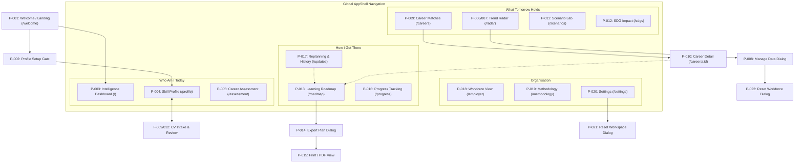
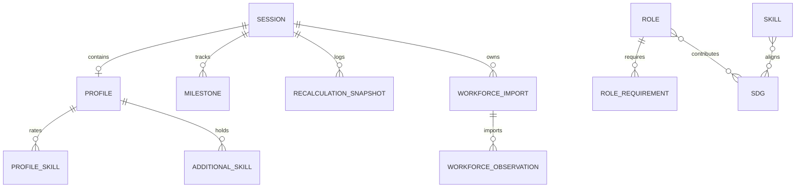

# Existing Application — Product Reverse-Engineering Specification

## Document Metadata
- **Product Name:** SKILLAX AI Platform (Future Workforce Intelligence & Career OS)
- **Target Audience / Domain:** Malaysian Workers, Lifelong Learners, Workforce Planners (SDC Aiversecity Domain 1)
- **Document Version:** 1.0.0
- **Analysis Status:** Complete & Verified via Full Source, API Contracts, Test Suites, Database Schemas, and UI System Reverse-Engineering
- **Deliverable Purpose:** Complete implementation-agnostic product specification for rebuild by an autonomous AI coding agent.

---

## Section 1: Executive Summary

### 1.1 Product Purpose & Problem Solved
SKILLAX AI is an explainable, deterministic career intelligence and lifelong learning operating system designed for workforce evolution. Built specifically for the Malaysian workforce context under the Aiversecity Future-Ready Workforce challenge, it addresses a fundamental problem in AI-driven career guidance: **the opacity and hallucination of black-box language models, the lack of verifiable market evidence, and the unapproved alteration of user learning plans.**

Rather than predicting hiring outcomes or acting as an employer candidate-screening filter, SKILLAX AI acts as human decision support. It empowers individual workers to:
1. Map their current capabilities (levels 0 to 5) across 19 standard skills.
2. Ingest CV data through consented external AI document extraction or local keyword rules, with mandatory human verification before any data enters the profile.
3. Explore 10 catalogued occupations referenced against O*NET occupational families, evaluating suitability using an open, 4- or 5-part mathematical scoring formula.
4. Track technical research activity and time-series workforce demand with strict statistical comparability rules.
5. Generate an actionable, gap-based 4-phase learning roadmap linking to free public learning hubs.
6. Adapt to three distinct AI adoption scenarios (Slower, Moderate, Rapid) and explore hypothetical market shifts.
7. Retain full ownership of their roadmap through human-in-the-loop replanning, ensuring no roadmap updates take effect without explicit user approval.
8. Understand social impact through comprehensive mapping to all 17 United Nations Sustainable Development Goals (SDGs).

### 1.2 Primary User Groups
1. **Malaysian Workers & Mid-Career Changers:** Professionals evaluating how AI adoption, industrial automation, and market trends impact their occupations, seeking structured, self-paced upskilling pathways.
2. **Recent Graduates & Job Seekers:** Individuals transitioning from education into employment, assessing transferable strengths, skill gaps, and practical portfolio projects.
3. **Workforce Planners & Employers (Planning View Only):** Organizational leaders reviewing aggregate workforce capabilities and training shortfalls across fictional cohorts, strictly prohibited from screening, ranking, or rejecting individuals.

### 1.3 Major Functional Areas
- **Workspace & Profile Onboarding:** Anonymous, signed-cookie sessions; profile setup gating; multi-attribute skill and constraint management; consented Gemini PDF CV analysis; offline demo CV intake; keyword text extraction; and a 5-step conversational assessment wizard.
- **Personal Intelligence Briefing:** Visual summary dashboard featuring top match highlights, radar capability polygons, stacked score decomposition bars, active milestone trackers, fresh research digests, and SDG footprint summaries.
- **Trend Radar & Workforce Demand:** Dual-mode market surveillance providing live RSS ingestion (Hugging Face Research & MIT AI News) alongside time-series workforce dataset ingestion (CSV/JSON), statistical comparability enforcement, and trend direction analytics (Rising, Declining, Stable).
- **Explainable Career Matching:** Transparent 0–100 suitability scoring decomposing direct skills (50%), transferable alignment (20%), interest fit (15%), research activity (15%), and an optional workforce demand indicator (10%), paired with granular proficiency gap breakdowns.
- **Scenario Lab & Sensitivity Simulation:** Dynamic scenario switching across Slower, Moderate, and Rapid AI adoption pathways, accompanied by a bidirectional hypothetical simulation boost slider (-100 to +100).
- **Learning Roadmaps, Progress & Replanning:** Automated 4-phase pathway generation; self-reported milestone completion; JSON export and print-ready PDF generation; phase-level effort analytics; and human-in-the-loop replanning reviews triggered by evidence shifts.
- **Social Impact & Organizational Intelligence:** Interactive directory of all 17 UN Sustainable Development Goals and an aggregated employer capability and shortfall matrix for synthetic worker cohorts.
- **Governance & Methodology:** Complete mathematical formula disclosures, source provenance catalogs, and algorithmic boundary statements.

### 1.4 Defining Capabilities & Ethical Safeguards
- **Deterministic Scoring:** The matching algorithm is purely mathematical and repeatable. Identical profile inputs and market evidence always generate identical scores and rankings.
- **Strict Separation of Evidence:** Scientific research mentions are explicit proxies for technical activity and are never conflated with job vacancies or salary growth. Non-synthetic workforce datasets require verified definitions, methods, and HTTPS attribution.
- **Consented & Ephemeral Document Processing:** Raw CV files and extracted texts are never persisted to disk or database. Processing is ephemeral; memory buffers are zeroed out; and model outputs are suggestions that merge into drafts only after user approval.
- **Human-in-the-Loop Replanning:** Underlying market data or scenario changes never silently alter a user's roadmap. The platform stages updates as proposals that the user can accept or reject. Completed milestones are never erased.
- **Support, Not Selection:** The platform explicitly disclaims hiring selection, employment probability prediction, or automated employee screening.

---

## Section 2: Application Structure



### 2.1 Navigation Hierarchy
The application uses an persistent AppShell layout with a left sidebar (desktop, width 256px / 16rem) or slide-over drawer (mobile, width 288px / 18rem), a sticky header with workspace synchronization status, scenario indicator, pending review alert chip, and theme toggle, and a main content viewport max-width of 1400px.

Navigation is structured into four conceptual lifecycle groups:
1. **Who am I today:**
   - **Intelligence (`/`):** Executive briefing, top match summary, radar shape, stacked component bars, active milestone, research digest, and SDG footprint.
   - **Skill profile (`/profile`):** Comprehensive editor for demographic details, 19 catalogue skills, interest tags, additional skills, and dual CV intake engines (Gemini PDF and Keyword text).
   - **Assessment (`/assessment`):** 5-step conversational assessment wizard translating everyday language into proficiency ratings.
2. **What tomorrow holds:**
   - **Trend radar (`/radar`):** Tabbed intelligence hub toggling between Research Activity (RSS feed signals) and Workforce Demand (time-series dataset trends), with dataset ingestion controls.
   - **Career matches (`/careers`):** Searchable, industry-filterable directory of 10 ranked roles with score rings, component breakdowns, and TARGET indicators.
   - **Scenarios (`/scenarios`):** Comparative testing lab for Slower, Moderate, and Rapid AI adoption pathways and hypothetical market simulation adjustments (-100 to +100).
   - **SDG impact (`/sdgs`):** Interactive matrix of all 17 United Nations Sustainable Development Goals linking to relevant occupations and user skills.
3. **How I get there:**
   - **Roadmap (`/roadmap`):** 4-phase structured learning pathway with self-reported milestone completion, resource links, hours estimates, and JSON/PDF export.
   - **Progress (`/progress`):** Completion rate score ring, weekly pace projections, phase-level effort charts, and recent activity log.
   - **Replanning (`/updates`):** Human-in-the-loop review interface comparing previous vs. current rankings with approve/reject actions and an immutable recalculation audit log.
4. **Organisation:**
   - **Workforce view (`/employer`):** Aggregated capability and training shortfall dashboard for a 3-person synthetic worker cohort, including a requirement coverage matrix.
   - **Methodology (`/methodology`):** Mathematical formulas, scenario parameters, O*NET mappings, and external provider/source disclosures.
   - **Settings (`/settings`):** Client-side display preferences (dark mode, reduce motion) and destructive workspace session reset.

### 2.2 Shared Screen Elements & Layout Conventions
- **App Header:** Displays brand logo, live synchronization status indicator dot, scenario indicator pill, pending replanning alert chip (`Plan update awaiting review`), and the theme toggle button.
- **Sidebar Profile Chip:** Displays user initials in an avatar ring, full name, and occupation. Clicking navigates directly to `/profile`.
- **PageHeader Component:** Standardized title block on all screens featuring an uppercase category eyebrow with pulsing dot, primary heading (28px font), descriptive subtitle, and contextual action buttons.
- **Panel Container:** Standardized card container with rounded corners (8px / 0.5rem), subtle border, optional glow accent (`panel-glow`), and staggered entrance animation.

---

## Section 3: Complete Feature Inventory

### Module 1: Session & Security Management

#### Feature F-001: Anonymous Session Management & Workspace Isolation
- **Module:** Session & Security
- **Purpose:** Provide every visitor with an isolated, secure, private workspace without requiring user account creation, passwords, or personally identifiable authentication.
- **Entry point:** Application initial load on any route.
- **User actions:** Open the platform in any modern web browser.
- **Behavior:** The system checks incoming request headers for a signed HTTP-only cookie named `skillax_demo`. If missing or invalid, it creates a fresh cryptographically secure UUIDv4 session identifier, signs it with a secret key, sets a cookie with a 30-day expiration, and initializes a blank session record in PostgreSQL. All subsequent profile edits, milestones, evidence records, and recalculations are partitioned by this session ID.
- **Inputs:** Signed session cookie `skillax_demo`.
- **Outputs:** HTTP response `Set-Cookie` header with flags: `HttpOnly`, `SameSite=Lax`, `Path=/`, `Max-Age=2592000` (30 days), and `Secure` (in production).
- **Business rules:**
  - Token must strictly match the regex `^[0-9a-f-]{36}$`.
  - Sessions must remain strictly isolated; no cross-session visibility or mutation is permitted.
  - All non-GET API requests enforce browser same-origin validation (`sec-fetch-site` and `origin` matching `host`). Cross-origin browser writes are rejected with HTTP 403 Forbidden.
- **States:**
  - Uninitialized (new anonymous visitor, empty profile).
  - Initialized (user has entered and saved a name).
- **Dependencies:** None.
- **Evidence status:** Verified.
- **Acceptance criteria:**
  - Visiting any route without a cookie sets a valid signed session cookie.
  - Two parallel private browser windows maintain completely independent profiles, roadmaps, and workforce datasets.
  - Cross-origin POST/PUT/DELETE requests return HTTP 403 Forbidden with `{ "error": "Cross-origin workspace writes are not permitted." }`.

#### Feature F-002: Profile Setup Routing Guard
- **Module:** Session & Security
- **Purpose:** Prevent users from viewing personalized career matches or roadmaps before entering their name and establishing a personal profile.
- **Entry point:** Direct navigation to `/`, `/assessment`, `/careers`, `/careers/:id`, `/roadmap`, `/progress`, `/scenarios`, `/sdgs`, or `/updates`.
- **User actions:** Attempt to navigate to any protected route prior to saving a profile name.
- **Behavior:** The router evaluates whether the destination route requires an active profile. If required and `profile.name.trim()` is empty, the application intercepts rendering and displays the `ProfileSetup` screen instead of the route's contents.
- **Inputs:** Destination URL path; session workspace profile state.
- **Outputs:** `ProfileSetup` component featuring a user icon, welcome title, explanatory body, and a prominent `Create My Profile` button.
- **Business rules:**
  - Routes requiring an initialized profile: `/`, `/assessment`, `/careers`, `/careers/:id`, `/roadmap`, `/progress`, `/scenarios`, `/sdgs`, `/updates`.
  - Routes accessible without a profile: `/welcome`, `/profile`, `/radar`, `/employer`, `/methodology`, `/settings`.
- **States:**
  - Gated: Name is empty string; protected views display setup prompt.
  - Ungated: Name contains non-whitespace characters; protected views render normally.
- **Dependencies:** F-001.
- **Evidence status:** Verified.
- **Acceptance criteria:**
  - In a fresh session, visiting `/` renders the Profile Setup card rather than the dashboard.
  - Clicking `Create My Profile` navigates to `/profile`.
  - Once a profile name is saved, all protected routes become immediately accessible.

#### Feature F-003: Full Workspace Reset
- **Module:** Session & Security
- **Purpose:** Allow the user to completely purge all personal data, roadmaps, progress, and imported evidence in the current session.
- **Entry point:** `/settings` -> Session panel -> `Reset workspace` button.
- **User actions:** Click `Reset workspace` button; confirm in the confirmation modal.
- **Behavior:** Precondition: Active session. User clicks the destructive button. System opens an alert dialog. On confirmation, sends action `reset` to the server. The server clears the session's profile, resets milestones to empty, deletes all imported workforce datasets, purges recalculation history, and resets scenario to moderate and simulation boost to 0.
- **Inputs:** User confirmation in modal.
- **Outputs:** Cleared session state; feedback toast `Workspace reset`; routing guard re-engages on protected routes.
- **Business rules:**
  - Confirmation modal is mandatory with destructive red button styling.
  - Clears ONLY data belonging to the current session ID; other sessions remain unaffected.
  - Profile state resets to fresh defaults (`name: ""`, `skills: []`, `profileCreated: false`).
- **States:** Idle; Confirmation Dialog Open; Executing; Reset Completed.
- **Dependencies:** F-001.
- **Evidence status:** Verified.
- **Acceptance criteria:**
  - Modal title reads `Reset the workspace?` with description warning that profile edits, roadmap, milestones, and workforce data will be cleared.
  - Clicking `Cancel` closes modal with zero changes.
  - Clicking `Reset` purges all session data and re-locks gated pages behind F-002.

#### Feature F-004: Client Preferences (Theme & Reduced Motion)
- **Module:** Session & Security
- **Purpose:** Allow users to toggle between dark/light visual themes and enable reduced motion for animations.
- **Entry point:** Header theme toggle icon OR `/settings` -> Display panel toggles.
- **User actions:** Click header sun/moon icon; toggle `Dark mode` switch; toggle `Reduce motion` switch.
- **Behavior:** Updates localStorage object `skillax-prefs`. Toggles class `.dark` and `.reduce-motion` on `document.documentElement`. Dispatches custom window event `skillax-prefs` to synchronize state across open browser tabs.
- **Inputs:** Boolean switch states.
- **Outputs:** Immediate CSS token shifts; localStorage update.
- **Business rules:**
  - Default preferences: `{ theme: "dark", reduceMotion: false, showUncertainty: true, compact: false }`.
  - Dark mode applies deep navy palette (`hsl(220 48.8% 8.4%)`); Light mode applies crisp slate palette (`hsl(210 40% 98%)`).
  - Reduced motion disables orbital rotations and entrance rise animations.
- **States:** Dark mode active / Light mode active; Standard motion / Reduced motion.
- **Dependencies:** None.
- **Evidence status:** Verified.
- **Acceptance criteria:**
  - Clicking header toggle flips `.dark` class immediately.
  - Preferences persist across page refreshes via localStorage.
  - Changes in one tab synchronize across other open tabs without page reload.

---

### Module 2: Skill Profile & Intake

#### Feature F-005: Manual Skill Profile Details & Parameter Editing
- **Module:** Skill Profile
- **Purpose:** Record user demographics, professional summaries, career constraints, and learning preferences.
- **Entry point:** `/profile` -> Details panel.
- **User actions:** Edit Name, Occupation, Industry, Education, Language text inputs; enter Experience (0–60), Weekly Hours (1–80), Budget (RM >= 0); enter Professional Summary (up to 1500 chars) and Experience Summary (up to 3000 chars); click `Save profile` or `Discard`.
- **Behavior:** Edits modify a local draft state. When draft differs from saved workspace profile, an unsaved changes alert bar appears and Discard/Save buttons activate. Clicking `Save profile` validates inputs, sends transaction to `/api/skillax/action` with action `saveProfile`, commits data, recalculates all 10 career match scores, and sets `replanningPending` to true if an existing roadmap exists.
- **Inputs:** Name (string, max 100), Occupation (string, max 200), Industry (string), Education (string), Language (string), Experience (number, 0–60), Weekly Hours (number, 1–80), Budget (number, >= 0), Professional Summary (string, max 1500), Experience Summary (string, max 3000).
- **Outputs:** Saved profile state; updated career matches; toast notification `Profile saved, matches recomputed`.
- **Business rules:**
  - Name is mandatory: `Save profile` button is disabled if `name.trim()` is empty.
  - Negative values for Experience, Weekly Hours, or Budget are strictly rejected. Typing `-` in number fields is blocked.
  - Experience capped at 60 years; Weekly Hours capped at 80 hours/week.
  - Match scores recalculate ONLY upon saving; drafting does not mutate server state.
- **States:** Pristine (draft matches server); Dirty (unsaved changes banner visible); Saving (spinner active); Saved.
- **Dependencies:** F-001.
- **Evidence status:** Verified.
- **Acceptance criteria:**
  - Save button is disabled when draft is pristine or Name is empty.
  - Typing negative numbers in experience is blocked at keydown and clamped on change.
  - Clicking `Discard` resets all inputs to the current server profile.
  - Saving commits data and updates match scores across all other application views.

#### Feature F-006: 19 Curated Catalogue Skills Rating
- **Module:** Skill Profile
- **Purpose:** Allow users to rate their competency across 19 standard skills on a discrete 0 (none) to 5 (expert) scale.
- **Entry point:** `/profile` -> Category panels (Transferable, Digital, Technical).
- **User actions:** Adjust sliders from 0 to 5 for any of the 19 skills.
- **Behavior:** Sliders represent integer ratings. If rating is 0, the skill is omitted from the saved profile skills array. If rating is 1–5, an object `{ skillId, level }` is stored. Modified skills are highlighted in primary cyan text. Panel subtitles display the count of rated skills (e.g. `3 of 6 rated`).
- **Inputs:** Slider value (integer 0, 1, 2, 3, 4, 5).
- **Outputs:** Updated draft skill list; category rated counter.
- **Business rules:**
  - The 19 standard skills:
    - *Transferable:* Communication (`communication`), Project coordination (`organization`), Responsible AI (`ethics`), User research & design (`design`), Training & facilitation (`teaching`).
    - *Digital:* Spreadsheets & Excel (`excel`), Data analysis (`analysis`), AI literacy (`ai`), Sustainability analysis (`sustainability`), Health data literacy (`health`).
    - *Technical:* Python programming (`python`), SQL & databases (`sql`), Machine learning (`ml`), Workflow automation (`automation`), Equipment maintenance (`maintenance`), Industrial IoT (`iot`), Cloud computing (`cloud`), Cybersecurity (`security`), Precision agriculture (`agriculture`).
  - Proficiencies must be integers between 0 and 5 inclusive.
  - Duplicate skill entries are strictly rejected by the server.
- **States:** Unrated (level 0, omitted from array); Rated (level 1–5).
- **Dependencies:** F-005.
- **Evidence status:** Verified.
- **Acceptance criteria:**
  - All 19 skills render with an interactive slider (min 0, max 5, step 1).
  - Setting a slider to 0 removes the skill from the payload array upon save.
  - Changed sliders highlight their label in primary accent color.

#### Feature F-007: Interests Tag Management
- **Module:** Skill Profile
- **Purpose:** Allow users to specify career interests that feed into the interest alignment scoring component.
- **Entry point:** `/profile` -> Details panel -> Interests.
- **User actions:** Type interest keyword in the input and press Enter; click `X` button on an existing tag badge.
- **Behavior:** Submitting text trims whitespace and appends the tag to `draft.interests` if not already present. Clicking `X` removes it. Tags are case-insensitively matched against role industries and role titles during career matching.
- **Inputs:** Text string.
- **Outputs:** List of dismissible badges; updated profile `interests` array.
- **Business rules:**
  - Duplicate interest tags are prevented.
  - Empty strings or whitespace-only inputs are ignored.
  - Matching an interest to a role's industry grants that role a maximum 100% interestScore.
- **States:** Empty list; Populated list.
- **Dependencies:** F-005.
- **Evidence status:** Verified.
- **Acceptance criteria:**
  - Typing an interest and hitting Enter creates a badge.
  - Duplicate entries are ignored.
  - Clicking `X` removes the badge immediately.

#### Feature F-008: Additional Non-Catalogue Skills Management
- **Module:** Skill Profile
- **Purpose:** Store specialized, bespoke user skills that fall outside the 19 standard matching catalogue skills.
- **Entry point:** `/profile` -> Additional skills panel (visible when `additionalSkills` array is populated).
- **User actions:** Edit skill name input; edit skill level input (0–5); click `X` button to delete skill.
- **Behavior:** Renders an editable row for each non-catalogue skill. Edits update the draft `additionalSkills` array. These skills are persisted in profile JSON but do NOT affect career match calculations or create artificial occupation requirements.
- **Inputs:** Custom skill name (max 100 chars), Level (integer 0–5).
- **Outputs:** Updated `additionalSkills` list.
- **Business rules:**
  - Maximum 60 additional skills permitted.
  - Must not match any catalogue skill name or ID (catalogue skills must be rated via F-006).
  - Additional skills NEVER alter career match scores or generate roadmap gaps.
- **States:** Hidden (zero additional skills); Visible (1 or more additional skills present).
- **Dependencies:** F-005.
- **Evidence status:** Verified.
- **Acceptance criteria:**
  - Panel only appears when additionalSkills contains at least one item.
  - User can modify custom skill names and levels.
  - Deleting an entry removes it from the draft.

#### Feature F-009: Consented Gemini PDF CV Analysis
- **Module:** Skill Profile
- **Purpose:** Extract structured career history and skill suggestions from a fictional PDF CV using Google Gemini AI.
- **Entry point:** `/profile` -> CV analysis panel -> Upload area.
- **User actions:** Select PDF file (<= 10 MB, <= 30 pages); check consent checkbox; check synthetic declaration checkbox; click `Analyze CV`.
- **Behavior:** Browser validates file size and MIME type. `Analyze CV` button activates only when file is selected and both checkboxes are checked. Sends multipart request to `POST /api/cv/analyze`. Server checks session validity, same-origin headers, enforces rate limits (6 req/15 min) and concurrency limit (max 2), validates PDF headers (`%PDF-` and `%%EOF`), and calls Gemini API (`gemini-3.5-flash-lite`) with structured output schema and strict system instruction. Returned facts are parsed and validated via Zod. Temporary memory buffer is zeroed out. Extracted facts are displayed in the review panel.
- **Inputs:** PDF document binary; form fields `consent="true"`, `synthetic="true"`.
- **Outputs:** Structured CV analysis payload (`currentRole`, `education`, `experienceYears`, `technicalSkills`, `softSkills`, `experience`, `projects`, `certifications`, `careerInterests`, `analysisNotes`).
- **Business rules:**
  - File must be valid PDF, <= 10 MB, 1 to 30 pages.
  - Both consent checkboxes must be explicitly ticked (`consent="true"` and `synthetic="true"`).
  - Rate limit: 6 requests per IP per 15 minutes; concurrency: max 2 active analyses.
  - Gemini prompt receives document as untrusted data with no tools; prompt injection instructions embedded in PDF are neutralized.
  - Skills lacking evidence citations are forced to `proficiency: "Unknown"`.
  - Raw CV files, full prompts, and raw model outputs are NEVER saved to database or logs.
- **States:** Idle; Ready to Analyze (file & consent valid); Analyzing (loading spinner, status message); Review Panel Active; Error.
- **Dependencies:** F-001, External Gemini API.
- **Evidence status:** Verified.
- **Acceptance criteria:**
  - Button is disabled until file is attached and both checkboxes are checked.
  - Selecting non-PDF or file >10 MB triggers client-side validation error.
  - Successful extraction opens review panel (F-012) with model badge `Gemini analysis · gemini-3.5-flash-lite`.
  - Server errors return safe user-facing error messages without exposing API keys.

#### Feature F-010: Offline Synthetic Demo CV Extraction
- **Module:** Skill Profile
- **Purpose:** Provide an offline, deterministic demonstration of CV extraction without making external AI calls.
- **Entry point:** `/profile` -> CV analysis panel -> Fictional sample CV section.
- **User actions:** Select sample profile from dropdown (`Computer Science Graduate`, `Administrative Assistant`, `Manufacturing Technician`); click `Try a Sample CV`.
- **Behavior:** Sends request to `POST /api/cv/demo` with `sampleId`. Server returns pre-configured synthetic extraction results. Review panel immediately opens, clearly labelled with: `Synthetic demo response · No Gemini call`.
- **Inputs:** `sampleId` string (`"graduate" | "admin" | "technician"`).
- **Outputs:** Pre-configured structured analysis payload.
- **Business rules:**
  - Never connects to Google or external networks.
  - Must explicitly disclose that output is synthetic demonstration data.
  - Allows full review workflow testing in environments without Gemini API credentials.
- **States:** Idle; Loading; Review Panel Active.
- **Dependencies:** F-001.
- **Evidence status:** Verified.
- **Acceptance criteria:**
  - Clicking `Try a Sample CV` immediately populates the review panel without external network requests.
  - Status header displays `Synthetic demo response · No Gemini call`.
  - Review panel fields accurately reflect the selected fictional persona.

#### Feature F-011: Fictional Sample CV PDF Download
- **Module:** Skill Profile
- **Purpose:** Provide users with genuine, pre-generated fictional PDF documents to test live file uploads.
- **Entry point:** `/profile` -> CV analysis panel -> `Download sample PDF` link.
- **User actions:** Click `Download sample PDF` link.
- **Behavior:** Initiates a browser download from `GET /api/cv/samples/:id`. The server dynamically generates a valid, standard PDF file corresponding to the selected sample persona (e.g. `skillax-fictional-graduate.pdf`).
- **Inputs:** `id` URL parameter (`"graduate" | "admin" | "technician"`).
- **Outputs:** Binary PDF file download stream.
- **Business rules:**
  - Generated PDF contains valid `%PDF-` header and `%%EOF` trailer.
  - Content explicitly includes header `SYNTHETIC CV - FOR DEMO ONLY`.
- **States:** Ready.
- **Dependencies:** F-001.
- **Evidence status:** Verified.
- **Acceptance criteria:**
  - Clicking link downloads a valid PDF matching the selected sample.
  - Downloaded PDF passes all validation checks when re-uploaded into F-009.

#### Feature F-012: CV Extraction Review & Merge to Draft
- **Module:** Skill Profile
- **Purpose:** Require human review, editing, and explicit approval of AI-suggested CV information before merging it into the profile draft.
- **Entry point:** `/profile` -> CV review panel (appears after F-009 or F-010).
- **User actions:** Edit suggested Occupation, Education, Experience years, and Interests; edit summaries; check/uncheck individual skills; change skill proficiency levels (Unknown to Level 5); click `Add missing skill`; click `Apply reviewed information to draft` or `Dismiss`.
- **Behavior:** Allows comprehensive editing of all extracted attributes. Clicking `Apply reviewed information to draft` merges approved fields into the active profile draft:
  - Exact or alias matches to catalogue skills update draft catalogue skills.
  - Unknown proficiency skills remain unrated (level 0) and do NOT contribute to scores.
  - Non-catalogue skills are appended to `additionalSkills`.
  - Text fields merge into draft.
  - Notification toast instructs user to click `Save profile`. Nothing is persisted to database until user saves the profile.
- **Inputs:** Form input edits, skill checkboxes, proficiency dropdowns.
- **Outputs:** Merged profile draft; toast notification `Applied to draft`.
- **Business rules:**
  - Applying to draft is strictly a client-side state merge; it is NOT a database write.
  - Unknown proficiency is treated as unrated (level 0) to prevent hallucinated positive score contributions.
  - Clicking `Dismiss` discards all suggested data without modifying the draft or database.
- **States:** Review active; Merged to draft; Dismissed.
- **Dependencies:** F-005, F-009 / F-010.
- **Evidence status:** Verified.
- **Acceptance criteria:**
  - Unchecking a skill excludes it from merging into the draft.
  - Applying changes updates form inputs on `/profile` and sets draft state to dirty.
  - Database is not modified until user explicitly clicks `Save profile`.

#### Feature F-013: Deterministic Keyword Text Intake
- **Module:** Skill Profile
- **Purpose:** Provide an alternative, offline text-based skill extraction method using regex keyword matching without AI language models.
- **Entry point:** `/profile` -> Expandable section `Optional keyword text intake (no Gemini)`.
- **User actions:** Upload text/PDF file OR paste synthetic CV text; click `Use sample` to load demo text; click `Extract skills`; review proposed changes; click `Apply to draft` or `Dismiss`.
- **Behavior:** Parses text in-browser (PDF text extracted via PDF.js; text files read directly). Sends text to `POST /api/skillax/intake`. Server scans text against documented regex aliases for 19 catalogue skills. Returns detected skills at Level 1. Client displays checklist. User selects skills and clicks `Apply to draft`, merging them into draft skills at max(current level, suggested level).
- **Inputs:** Text string (max 30,000 characters).
- **Outputs:** Proposed skill changes list; explanatory disclosure.
- **Business rules:**
  - Purely deterministic regex keyword matching; no LLM is used.
  - Suggested skills default to unverified level 1.
  - Raw text is discarded immediately after analysis; never stored in session or database.
- **States:** Collapsed; Text input active; Proposals displayed; Applied.
- **Dependencies:** F-005.
- **Evidence status:** Verified.
- **Acceptance criteria:**
  - Pasting text with keywords 'Excel' and 'Python' detects excel and python at level 1.
  - Explanation explicitly discloses deterministic keyword rules.
  - Applying updates the draft skill sliders with toast confirmation.

#### Feature F-014: Career Assessment Wizard
- **Module:** Assessment
- **Purpose:** Guide users through a structured 5-step conversational assessment to rate skills and constraints in plain language.
- **Entry point:** `/assessment`.
- **User actions:** Step 1: Select sector interest buttons; Step 2: Enter hours/week and budget; Steps 3–5: Rate skills using descriptive 6-point scale; navigate with Back/Next; click `Update my profile` on final step.
- **Behavior:** Step progress bar tracks completion. Descriptive scale maps human phrases to numeric levels:
  - `0`: "Never done it"
  - `1`: "Seen it done"
  - `2`: "Done with help"
  - `3`: "Do it on my own"
  - `4`: "Others ask me"
  - `5`: "I teach it"
  On final step, clicking `Update my profile` commits profile changes directly via `saveProfile` action, recalculates matches, and automatically navigates to `/careers`.
- **Inputs:** Sector button toggles; Weekly hours (1–80); Budget (>= 0); Scale button selections per skill.
- **Outputs:** Saved profile; automatic redirection to `/careers`; toast notification.
- **Business rules:**
  - Total steps = 2 + number of skill categories (5 steps total).
  - Submitting commits profile directly to the database without requiring an intermediate draft save.
  - Updates career match scores and triggers replanning proposal if a roadmap exists.
- **States:** Steps 0 through 4; Submitting; Redirecting.
- **Dependencies:** F-001, F-005.
- **Evidence status:** Verified.
- **Acceptance criteria:**
  - Progress bar reflects step completion.
  - Selecting descriptive options sets underlying 0–5 level.
  - Submitting updates profile and lands on `/careers` with recalculations complete.

---

### Module 3: Intelligence Dashboard & Overview

#### Feature F-015: Personal Intelligence Briefing & Top Match Card
- **Module:** Dashboard
- **Purpose:** Present an executive overview of user capabilities and highlight their strongest matching career opportunity.
- **Entry point:** `/` (Dashboard root).
- **User actions:** Click `Explore top match` button; click `Refine skills` button; click top match card.
- **Behavior:** Greets user with their first name. Summarizes mapped skills, categories, catalogued roles, and signals. Prominently features the #1 ranked role with overall score ring (0–100), industry, estimated learning hours, gap count, and carry-over count. Clicking the card navigates directly to `/careers/:topRoleId`.
- **Inputs:** Workspace profile and ranked matches.
- **Outputs:** Hero briefing text; Score ring; Target match summary card.
- **Business rules:**
  - Top match is the first element of `ranked` matches sorted by score descending.
  - Score ring renders a gradient circle scaled by `score / 100`.
- **States:** Matches populated; No matches empty state.
- **Dependencies:** F-002, F-005, F-032.
- **Evidence status:** Verified.
- **Acceptance criteria:**
  - Correctly displays user's first name and top career match.
  - Card displays role title, score, hours, gaps, and carry-over skills.
  - Clicking card routes to `/careers/:roleId`.

#### Feature F-016: Skill Shape vs. Strongest Pathway Radar Chart
- **Module:** Dashboard
- **Purpose:** Visually compare the user's category capabilities against the requirements of their top match.
- **Entry point:** `/` -> `Skill shape vs strongest pathway` panel.
- **User actions:** Hover over chart vertices to view category scores.
- **Behavior:** Renders an SVG radar chart. Calculates the user's average skill level per category (Transferable, Digital, Technical) rendered as a solid cyan polygon. Renders top role's average requirements as a dashed violet polygon outline.
- **Inputs:** User skill ratings; Top role requirement levels.
- **Outputs:** Interactive radar chart; tooltip with numeric averages.
- **Business rules:**
  - Category level = sum of levels in category / count of skills in category.
  - Radius domain is fixed at 0 to 5.
- **States:** Rendered chart; Tooltip active on hover.
- **Dependencies:** F-015.
- **Evidence status:** Verified.
- **Acceptance criteria:**
  - Radar chart plots Transferable, Digital, and Technical categories.
  - User shape is solid cyan; role requirement shape is dashed violet.
  - Tooltips display exact values to 2 decimal places.

#### Feature F-017: Ranked Roles Score Decomposition Stacked Bar Chart
- **Module:** Dashboard
- **Purpose:** Provide an at-a-glance mathematical breakdown of match scores across the top 6 careers.
- **Entry point:** `/` -> `Why these roles rank` panel.
- **User actions:** Hover over stacked bar segments; click `All matches` link.
- **Behavior:** Renders horizontal stacked bars for the top 6 roles. Each bar decomposes the total score into its constituent weighted points: Direct skills (chart-1), Transferable (chart-2), Interest fit (chart-3), Research activity (chart-4), and Workforce indicator (chart-5, if present).
- **Inputs:** Top 6 ranked matches array.
- **Outputs:** Horizontal stacked bar chart (0–100 scale); color legend.
- **Business rules:**
  - Bar segments represent weighted point contributions (`raw_score * weight`).
  - Total length equals the final match score.
  - Clicking `All matches` navigates to `/careers`.
- **States:** 4-component mode; 5-component mode (when workforce evidence is present).
- **Dependencies:** F-032.
- **Evidence status:** Verified.
- **Acceptance criteria:**
  - Shows top 6 roles on Y-axis.
  - Bars stack accurately to equal the final score.
  - Legend shows color keys for all active components.

#### Feature F-018: Next Move Active Roadmap Milestone Card
- **Module:** Dashboard
- **Purpose:** Surface the immediate next learning action for the user's active roadmap.
- **Entry point:** `/` -> `Next move` panel.
- **User actions:** Click `Open roadmap` button; click `Choose a target` button (if roadmap is empty).
- **Behavior:** If a roadmap exists, finds the first uncompleted milestone by phase order and displays its phase, title, objective, provider, hours, and an overall roadmap progress bar. If all milestones are completed, displays congratulatory text. If no roadmap exists, displays an empty state with CTA to choose a target.
- **Inputs:** Roadmap milestones array.
- **Outputs:** Active milestone card OR empty state.
- **Business rules:**
  - Active milestone is the first item where `completed === false` in phase-sorted array.
  - Progress bar width = `(completed_count / total_count) * 100%`.
- **States:** Milestone pending; All milestones complete; No roadmap generated.
- **Dependencies:** F-042.
- **Evidence status:** Verified.
- **Acceptance criteria:**
  - Correctly displays next incomplete milestone title and hours.
  - Progress bar reflects overall roadmap completion percentage.
  - Clicking `Open roadmap` navigates to `/roadmap`.

#### Feature F-019: Fresh Research Evidence Digest
- **Module:** Dashboard
- **Purpose:** Display the most recent public research publications affecting the skill ecosystem.
- **Entry point:** `/` -> `Fresh evidence` panel.
- **User actions:** Read recent research signals; click `Radar` link.
- **Behavior:** Displays the 4 most recently published research signals with trend icon (green arrow up for rising/emerging, red arrow down for declining, neutral dash for stable/research), title, source name, and publication date.
- **Inputs:** Cached signals array.
- **Outputs:** List of 4 signal items.
- **Business rules:**
  - Sorted descending by `publishedAt`.
  - Subtitle explicitly notes: `Research signals, not proof of job demand`.
- **States:** Populated list; Empty list.
- **Dependencies:** F-023.
- **Evidence status:** Verified.
- **Acceptance criteria:**
  - Lists exactly 4 most recent signals sorted by publication date.
  - Shows directional icon, source name, and formatted date.
  - Clicking `Radar` navigates to `/radar`.

#### Feature F-020: SDG Impact Footprint Card
- **Module:** Dashboard
- **Purpose:** Highlight the United Nations Sustainable Development Goals most strongly connected to the user's profile and top pathways.
- **Entry point:** `/` -> `Impact footprint` panel.
- **User actions:** Click `All 17` link.
- **Behavior:** Computes goal connection frequency across the user's active skills (weight 1) and top 3 career matches (weight 2). Renders the top 6 linked SDGs with official colored badges and link counts.
- **Inputs:** Active user skills; Top 3 career matches; SDG definitions.
- **Outputs:** Ranked list of up to 6 linked SDGs with badges and counts.
- **Business rules:**
  - Top 3 roles contribute 2 points per linked SDG; active skills contribute 1 point per linked SDG.
  - Sorted descending by total link points.
- **States:** Populated footprint.
- **Dependencies:** F-048.
- **Evidence status:** Verified.
- **Acceptance criteria:**
  - Renders top 6 connected goals with official color badges and link counts.
  - Clicking `All 17` navigates to `/sdgs`.

#### Feature F-021: Workspace Activity Audit Log
- **Module:** Dashboard
- **Purpose:** Display a chronological audit trail of all major user actions in the current session.
- **Entry point:** `/` -> `Recent activity` panel.
- **User actions:** Inspect recent session events.
- **Behavior:** Renders a vertical timeline showing up to the 6 most recent session events (e.g. profile saved, roadmap generated, milestone completed, research refreshed) with formatted relative dates and timestamps.
- **Inputs:** Workspace `activity` array.
- **Outputs:** Vertical timeline list.
- **Business rules:**
  - Activity array capped at 30 items on server.
  - Chronological descending order (newest first).
- **States:** Populated activity; Empty activity.
- **Dependencies:** F-001.
- **Evidence status:** Verified.
- **Acceptance criteria:**
  - Displays up to 6 newest activity items with timestamp.
  - Reflects real session actions.

#### Feature F-022: Dynamic Replanning Banner & Alert Chip
- **Module:** Navigation & Notifications
- **Purpose:** Provide immediate visual alerts whenever market evidence or profile changes propose an update to the user's saved learning plan.
- **Entry point:** Global header and `/` (Dashboard root).
- **User actions:** Click header alert chip OR click dashboard warning banner.
- **Behavior:** When `ws.replanningPending` is true, displays a prominent pulsing banner on the dashboard, an alert chip in the top header (`Plan update awaiting review`), and a `REVIEW` badge on the sidebar Replanning link. Clicking any alert navigates to `/updates`.
- **Inputs:** `ws.replanningPending` boolean flag.
- **Outputs:** Visible banner, chip, and badge.
- **Business rules:**
  - `replanningPending` is true when rank order changes, a score changes by >= 1.0 point, or milestone priorities change, AND a roadmap is present.
  - Alerts disappear immediately once the user approves or rejects the replan.
- **States:** Hidden (no pending changes); Active (pending review).
- **Dependencies:** F-046.
- **Evidence status:** Verified.
- **Acceptance criteria:**
  - Banner and header chip appear when `replanningPending` is true.
  - Clicking navigates directly to `/updates`.
  - Disappears upon plan approval or rejection.

---

### Module 4: Market Signals & Trend Radar

#### Feature F-023: Public Research Feeds Retrieval & Refresh
- **Module:** Trend Radar
- **Purpose:** Fetch and ingest real-world engineering and research RSS feeds (Hugging Face and MIT AI News) to update technical activity signals.
- **Entry point:** `/radar` -> Header `Refresh public research` button.
- **User actions:** Click `Refresh public research` button.
- **Behavior:** Triggers `POST /api/skillax/action` with action `refreshTrends`. Server fetches RSS XML from Hugging Face and MIT AI News (15-second timeout, 3 MB limit), parses articles, matches regex keywords to catalogue skills, updates database table `trendObservations`, and returns up to 60 signals. Server enforces a 1-minute rate limit. If network fetch fails, cached observations are preserved and an error banner is displayed.
- **Inputs:** User button click.
- **Outputs:** Updated `signals` array; updated `lastRefresh` timestamp; error banner if failed.
- **Business rules:**
  - Feeds: Hugging Face Research (`https://huggingface.co/blog/feed.xml`) and MIT AI News (`https://news.mit.edu/rss/topic/artificial-intelligence2`).
  - Rate limit: 1 request per 60 seconds. Rapid calls return cached results with a rate-limit notice.
  - Keyword matches represent technical research activity, NOT job demand.
  - Modes: `live`, `cached`, `fallback`.
- **States:** Idle; Refreshing (spinner active); Refreshed; Error banner visible.
- **Dependencies:** F-001.
- **Evidence status:** Verified.
- **Acceptance criteria:**
  - Clicking button triggers fetch with loading spinner.
  - Timestamp updates on success.
  - Rapid repeated clicks trigger rate-limit message and preserve latest data.
  - Network failure displays error banner while retaining cached data.

#### Feature F-024: Research Activity Signals Filtering & Keyword Search
- **Module:** Trend Radar
- **Purpose:** Search and filter public research signals by text, direction, retrieval mode, and tagged skill.
- **Entry point:** `/radar` -> Research Activity tab -> Filter bar.
- **User actions:** Type query in search input; select Direction dropdown; select Mode dropdown; select Skill dropdown.
- **Behavior:** Real-time client-side filtering across signals array. Searches case-insensitively across title, source, and observation text. Filters by direction (`Research activity`), mode (`live`, `cached`, `synthetic`), and tagged skill ID. If no signals match, renders an empty state.
- **Inputs:** Search string, Direction dropdown, Mode dropdown, Skill dropdown.
- **Outputs:** Filtered grid of signal cards OR empty state.
- **Business rules:**
  - All filter conditions are combined with logical AND.
  - Empty state provides a prompt to loosen filters.
- **States:** All signals displayed; Filtered subset displayed; Zero matches empty state.
- **Dependencies:** F-023.
- **Evidence status:** Verified.
- **Acceptance criteria:**
  - Typing a keyword filters signal cards in real time.
  - Selecting a skill displays only cards tagged with that skill.
  - Empty results show 'No signals match' empty state.

#### Feature F-025: Research Provenance & Transparency Display
- **Module:** Trend Radar
- **Purpose:** Ensure complete auditability and source attribution for every public research signal.
- **Entry point:** `/radar` -> Research Activity tab -> Signal cards.
- **User actions:** Inspect card metadata; click external link icon.
- **Behavior:** Each card displays directional trend icon, direction label, retrieval mode badge (`live`, `cached`), article title, summary observation text, tagged skill badges, source publisher name, publication date, retrieval date, and an HTTPS external link opening the original article in a new tab.
- **Inputs:** Signal object.
- **Outputs:** Formatted card with external link.
- **Business rules:**
  - External links must use HTTPS and open in new tab with `rel="noreferrer"`.
  - Discloses that observations are research-activity proxies.
- **States:** Rendered card.
- **Dependencies:** F-023.
- **Evidence status:** Verified.
- **Acceptance criteria:**
  - Displays source, publication date, retrieval date, and mode badge.
  - Clicking external link opens original article URL in new tab.

#### Feature F-026: Evidence Article Count per Skill Bar Chart
- **Module:** Trend Radar
- **Purpose:** Visualize the distribution of research literature across catalogued skills.
- **Entry point:** `/radar` -> Research Activity tab -> Bar chart panel.
- **User actions:** Hover over chart bars.
- **Behavior:** Counts signals tagged to each skill across the evidence pool and renders a vertical bar chart of the top 10 skills. Tooltip shows exact article count.
- **Inputs:** Current signals array.
- **Outputs:** Bar chart of top 10 skills.
- **Business rules:**
  - Top 10 skills sorted descending by article count.
  - Explicitly states: `Counts of articles, not demand`.
- **States:** Rendered chart.
- **Dependencies:** F-023.
- **Evidence status:** Verified.
- **Acceptance criteria:**
  - Renders top 10 skills by tag frequency.
  - Tooltip shows exact article count.

#### Feature F-027: Workforce Demand Trend Analytics & Filtering
- **Module:** Trend Radar
- **Purpose:** Explore time-series workforce indicators and trends derived from imported workforce datasets.
- **Entry point:** `/radar` -> Workforce Demand tab.
- **User actions:** Select Skill dropdown; select Industry dropdown; select Geography dropdown; select Source dropdown; select Comparable series dropdown; select Period window (All, Last 2, Last 4).
- **Behavior:** Filters session workforce trends. Selecting a series displays its trend label badge (Rising/Declining/Stable/Insufficient Data), source attribution, geography, unit, and methodology. If no workforce data exists, displays an empty state prompting user to `Manage Data`.
- **Inputs:** Filter dropdown selections, Series selection, Period window selection.
- **Outputs:** Trend summary panel OR empty state.
- **Business rules:**
  - Empty state displayed when `workforceTrends` array is empty.
  - Dropdowns hidden if only one option exists.
  - Never averages across independent series, definitions, or geographies.
- **States:** Empty state (no data); Filtered series displayed; No series matches empty state.
- **Dependencies:** F-028, F-030.
- **Evidence status:** Verified.
- **Acceptance criteria:**
  - Empty state guides user to `Manage Data` when no datasets are imported.
  - Selecting filters updates available comparable series.
  - Displays source name, geography, unit, and methodology disclosures.

#### Feature F-028: Workforce Trend Chronological Line Chart & Comparability Engine
- **Module:** Trend Radar
- **Purpose:** Enforce statistical comparability standards before plotting time-series workforce trends.
- **Entry point:** `/radar` -> Workforce Demand tab -> Series panel.
- **User actions:** View line chart; expand `Sources, measurement periods and limitations` details.
- **Behavior:** Checks whether series observations meet comparability rules (identical source, definition, method, unit, frequency class, and non-overlapping periods). If comparable, renders an SVG line chart of values over time and calculates absolute and percentage change across the last two periods. If non-comparable, suppresses the chart and displays an explanatory comparability limitation box.
- **Inputs:** Series observations array.
- **Outputs:** Line chart OR comparability warning box; observation list with dates, values, and limitations.
- **Business rules:**
  - Requires >= 2 non-overlapping observations of matching periodClass.
  - Percentage change = `100 * (current - previous) / previous`.
  - Relative change > +5% is `Rising`; < -5% is `Declining`; otherwise `Stable`.
  - If previous value is 0, percentage change is null and label is `Insufficient Data`.
- **States:** Comparable series (line chart rendered); Incomparable series (warning message rendered).
- **Dependencies:** F-027.
- **Evidence status:** Verified.
- **Acceptance criteria:**
  - Compatible series renders clean line chart with data points.
  - Incompatible series renders box explaining exact comparability limitation.
  - Displays absolute change and percentage change between last two compatible periods.

#### Feature F-029: Synthetic Workforce Baseline & Update Loading
- **Module:** Trend Radar
- **Purpose:** Allow one-click loading of pre-packaged synthetic workforce datasets to test scoring recalculation and replanning.
- **Entry point:** `/radar` -> `Manage Data` modal -> Sample buttons.
- **User actions:** Click `Load synthetic baseline`; click `Load synthetic update`.
- **Behavior:** Fetches pre-packaged JSON from public assets (`workforce-baseline.json` or `workforce-update.json`), populates the dataset textarea, sets format to JSON, and clears previous errors/previews. Baseline provides Q1/Q2 observations; update provides Q3 shifted observations.
- **Inputs:** Button click.
- **Outputs:** Textarea populated with formatted JSON.
- **Business rules:**
  - Baseline contains Q1 and Q2 2026 observations (stable baseline).
  - Update contains Q3 2026 observations with shifted values (triggers replanning).
- **States:** Idle; Populated textarea.
- **Dependencies:** F-030.
- **Evidence status:** Verified.
- **Acceptance criteria:**
  - Clicking baseline button loads baseline JSON into textarea.
  - Clicking update button loads update JSON into textarea.

#### Feature F-030: Custom Workforce Dataset Ingestion & Validation
- **Module:** Trend Radar
- **Purpose:** Validate and atomically ingest user-supplied CSV or JSON workforce datasets into the active session.
- **Entry point:** `/radar` -> Header `Manage Data` button -> Modal.
- **User actions:** Select format (CSV/JSON); select file OR paste text; click `Validate & preview`; inspect preview table (first 20 rows); click `Confirm import`.
- **Behavior:**
  - **Validate mode (`confirm: false`):** Server validates syntax, field lengths, dates (YYYY-MM-DD or YYYY-Qn), units, supported skills, HTTPS URLs, and value bounds without saving. Generates SHA-256 checksum and returns 20-row preview.
  - **Confirm mode (`confirm: true`):** Verifies that `previewChecksum` matches payload. Atomically inserts observations into database table `workforceImports`, updates session workforce trends, recalculates career matches, and triggers replanning snapshot if scores change.
- **Inputs:** `format` ('csv' | 'json'), `content` (string, max 1 MB), `confirm` (boolean), `previewChecksum` (string).
- **Outputs:** Preview table (recordsAccepted, checksum); committed import record; updated workspace.
- **Business rules:**
  - File size limit: 1 MB.
  - Import row limit: 1 to 500 records per import; max 5000 records per session.
  - Duplicate observations (matching series identity, period, and version) strictly rejected.
  - Non-synthetic observations require HTTPS `sourceUrl`, `definition`, and `method`.
  - Supported units: `count`, `job_postings`, `percent`, `percentage`, `index`, `synthetic_index`.
- **States:** Input empty; Validating; Validated preview; Confirming; Committed.
- **Dependencies:** F-001.
- **Evidence status:** Verified.
- **Acceptance criteria:**
  - Preview mode does NOT save records to database.
  - Confirming with mismatched checksum returns HTTP 400.
  - Duplicate records trigger atomic transaction rollback.
  - Successfully imported records immediately alter career match scores.

#### Feature F-031: Session Workforce Evidence Reset
- **Module:** Trend Radar
- **Purpose:** Clear all imported workforce observations in the current session while preserving the user profile, roadmap, and milestone completion.
- **Entry point:** `/radar` -> `Manage Data` modal -> `Reset workforce demo data` button.
- **User actions:** Click `Reset workforce demo data` button; confirm in alert dialog.
- **Behavior:** Sends action `resetWorkforce` to `/api/skillax/action`. Deletes all records in `workforceImports` for the active session ID. Recalculates career matches back to the 4-component baseline, logs a recalculation snapshot, and retains profile, roadmap, and completed milestones.
- **Inputs:** User confirmation in modal.
- **Outputs:** Cleared workforce observations; reverted 4-component match scores; toast notification.
- **Business rules:**
  - Deletes ONLY workforceImports for the active session.
  - Preserves user profile, roadmap milestones, completion checkmarks, and history.
- **States:** Idle; Confirmation modal; Reset completed.
- **Dependencies:** F-030.
- **Evidence status:** Verified.
- **Acceptance criteria:**
  - Clearing workforce data empties the Workforce Demand tab.
  - Career match scores revert to 4-component baseline.
  - Profile attributes and completed milestones remain completely intact.

---

### Module 5: Career Exploration & Matching

#### Feature F-032: Scenario-Driven Deterministic Career Matching
- **Module:** Career Matches
- **Purpose:** Calculate explainable suitability scores and skill gaps for all 10 catalogued occupations.
- **Entry point:** Automatic calculation across all match views.
- **User actions:** None (automatic deterministic calculation).
- **Behavior:** Evaluates the 10 catalogued roles against the user profile. Calculates:
  - `skillsScore`: direct requirement alignment (50% weight).
  - `transferableScore`: transferable category alignment (20% weight).
  - `interestScore`: sectoral alignment (15% weight).
  - `marketScore`: research activity index (15% weight).
  - `workforceScore`: optional workforce demand indicator (10% weight, scaling baseline to 90%).
  Ranks roles descending by overall score.
- **Inputs:** Profile skills, interests, active scenario, simulation boost, research signals, workforce observations.
- **Outputs:** Array of 10 Match objects with scores, gaps, relevant skills, hours, and mathematical explanations.
- **Business rules:**
  - Baseline score = `round(0.50 * skills + 0.20 * transferable + 0.15 * interest + 0.15 * market)`.
  - When workforce demand indicator is present: `score = round(baseline * 0.90 + workforceScore * 0.10)`.
  - Hours = `sum(ceil(resource_hours * (1 - current_level / required_level))) + 16`.
- **States:** Calculated.
- **Dependencies:** F-005.
- **Evidence status:** Verified.
- **Acceptance criteria:**
  - Scores strictly bounded between 0 and 100.
  - Missing skills lists all requirements where current < required.
  - Identical inputs produce identical rankings.

#### Feature F-033: Career Matches Directory & Search
- **Module:** Career Matches
- **Purpose:** Browse, filter, and inspect all ranked career opportunities.
- **Entry point:** `/careers`.
- **User actions:** Type role name in search input; select Industry filter dropdown; click any career card.
- **Behavior:** Renders ranked cards showing rank number (`#1`), score ring, role title, industry, gap count, learning hours, SDG badges, and component mini-bars. Current target role displays `TARGET` badge and glow styling. Clicking card navigates to `/careers/:id`.
- **Inputs:** Search query, Industry filter.
- **Outputs:** Filtered list of career cards.
- **Business rules:**
  - Search matches role title case-insensitively.
  - Target role card displays prominent `TARGET` pill.
- **States:** Populated list; No roles found empty state.
- **Dependencies:** F-032.
- **Evidence status:** Verified.
- **Acceptance criteria:**
  - Filtering by industry displays only roles in that industry.
  - Searching 'analyst' displays all analyst occupations.
  - Clicking a card navigates to `/careers/:id`.

#### Feature F-034: Four/Five-Component Score Decomposition & Mathematical Audit
- **Module:** Career Matches
- **Purpose:** Allow users to audit every point and formula contributing to a career match score.
- **Entry point:** `/careers/:id` -> `Score decomposition` panel.
- **User actions:** Hover over horizontal bar chart components; read mathematical explanation paragraph.
- **Behavior:** Renders central score ring, sum equation (e.g. `28.3 + 16.0 + 15.0 + 9.8 = 69.1`), a horizontal bar chart of raw vs. weighted points per component, and an audit paragraph stating the exact formula, signals, and occupational sources.
- **Inputs:** Role match object.
- **Outputs:** Score ring; Bar chart; Audit text box.
- **Business rules:**
  - Sum of weighted points equals final match score within 0.1 rounding.
  - Discloses proxy nature of research signals and modelling assumptions.
- **States:** Rendered.
- **Dependencies:** F-032.
- **Evidence status:** Verified.
- **Acceptance criteria:**
  - Bar chart accurately plots raw score and weighted points for each component.
  - Explanation paragraph states exact formula, weights, and source references.

#### Feature F-035: Proficiency Gap Analysis & Level Comparison
- **Module:** Career Matches
- **Purpose:** Compare user's current skill levels against role requirements.
- **Entry point:** `/careers/:id` -> `Proficiency gaps` panel.
- **User actions:** Inspect comparative bar chart; review gap list with level dots.
- **Behavior:** Displays dual-bar chart showing Current level (cyan) vs. Required level (violet) from 0 to 5 for every required skill. Below the chart, lists each requirement with LevelDots visualizer and shortfall badge (`met` or `-X`).
- **Inputs:** User skill ratings; Role requirements.
- **Outputs:** Dual-bar chart; Gap breakdown list.
- **Business rules:**
  - Shortfall = `Required - Current` (when Current < Required).
  - Status is `met` when Current >= Required.
- **States:** Rendered.
- **Dependencies:** F-032.
- **Evidence status:** Verified.
- **Acceptance criteria:**
  - Dual-bar chart plots Current vs Required levels (0–5) for all requirements.
  - LevelDots represents current rating and required ring.
  - Shortfall badges show exact point gaps or 'met'.

#### Feature F-036: Target Role Selection
- **Module:** Career Matches
- **Purpose:** Designate a specific career as the primary target for roadmap generation and tracking.
- **Entry point:** `/careers/:id` -> `Set as target` button.
- **User actions:** Click `Set as target` button.
- **Behavior:** Sends action `selectRole` with role ID. Updates `selectedRoleId` in session. Button changes to disabled `Current target`. Role receives TARGET badge across the app.
- **Inputs:** `role.id`.
- **Outputs:** Updated `selectedRoleId`; toast notification `Target role set`.
- **Business rules:**
  - Button is disabled if role is already the current target.
  - Selection persists in session state.
- **States:** Not target (`Set as target` button); Current target (disabled `Current target` button).
- **Dependencies:** F-001.
- **Evidence status:** Verified.
- **Acceptance criteria:**
  - Clicking `Set as target` updates `selectedRoleId`.
  - Button label changes to `Current target` and disables.
  - Role card on `/careers` receives TARGET badge.

#### Feature F-037: Career-Specific SDG Connection & Rationale
- **Module:** Career Matches
- **Purpose:** Explain how a specific career path contributes to UN Sustainable Development Goals.
- **Entry point:** `/careers/:id` -> `Sustainable Development Goals` panel.
- **User actions:** Inspect SDG badges; read SDG rationale text; inspect transferable strengths and missing skills pills.
- **Behavior:** Displays official colored SDG badges, full rationale text detailing specific SDG target connections (e.g. 8.2, 9.5), and pill lists of transferable strengths vs. missing skills.
- **Inputs:** Role `sdgs` array; Role `sdgRationale` text.
- **Outputs:** SDG badges; Rationale text; Skill pill badges.
- **Business rules:**
  - Discloses that connections are documented contribution pathways, not measured impact.
- **States:** Rendered.
- **Dependencies:** F-048.
- **Evidence status:** Verified.
- **Acceptance criteria:**
  - Displays correct SDG badges for the role.
  - Displays complete rationale text and skill pills.

#### Feature F-038: O*NET Occupational Reference Linkage
- **Module:** Career Matches
- **Purpose:** Provide external reference standards for career definitions.
- **Entry point:** `/careers/:id` -> `Occupational reference` link.
- **User actions:** Click `Occupational reference` link.
- **Behavior:** Opens the corresponding O*NET OnLine summary report in a new tab (e.g. `https://www.onetonline.org/link/summary/15-2051.01`).
- **Inputs:** Role `sourceUrl`.
- **Outputs:** New browser tab with O*NET data.
- **Business rules:**
  - Link must open in new tab with `target="_blank"` and `rel="noreferrer"`.
  - Discloses that proficiency levels are SKILLAX modelling choices, not official O*NET measurements.
- **States:** Ready.
- **Dependencies:** None.
- **Evidence status:** Verified.
- **Acceptance criteria:**
  - Clicking link opens valid O*NET summary URL in new tab.

---

### Module 6: Scenario Lab & Simulation

#### Feature F-039: AI Adoption Scenario Switching
- **Module:** Scenario Lab
- **Purpose:** Compare career stability and requirements under Slower, Moderate, and Rapid AI adoption pathways.
- **Entry point:** `/scenarios` -> Scenario panels.
- **User actions:** Click `Apply` button on Slower, Moderate, or Rapid adoption card.
- **Behavior:** Sends action `setScenario`. Updates active scenario in session, modifies role requirements (Rapid increases AI literacy level by 1 or adds Level 3; Slower decreases by 1, min 1), recalculates career matches, and triggers replanning proposal if roadmap exists.
- **Inputs:** `id` ('slower' | 'moderate' | 'rapid').
- **Outputs:** Updated workspace scenario; recalculated scores; toast notification.
- **Business rules:**
  - Slower: AI literacy requirement reduced by 1 (min 1); market effect = `-10 * techShare + 0.05 * exposure`.
  - Moderate: standard requirements; market effect = `0`.
  - Rapid: AI literacy requirement increased by 1 (max 5) or added at level 3; market effect = `20 * techShare - 0.1 * exposure`.
  - Scenarios are modelling assumptions, not measured forecasts.
- **States:** Active scenario (glowing card with `Active` button); Inactive scenario (`Apply` button).
- **Dependencies:** F-001, F-032.
- **Evidence status:** Verified.
- **Acceptance criteria:**
  - Clicking `Apply` switches active scenario across app and header tag.
  - Rapid scenario increases AI requirements on roles and modifies scores.
  - Slower scenario decreases AI requirements and adjusts scores.

#### Feature F-040: Cross-Scenario Score Comparison Chart
- **Module:** Scenario Lab
- **Purpose:** Compare career match scores across all three adoption pathways side-by-side.
- **Entry point:** `/scenarios` -> `Side by side` panel.
- **User actions:** Hover over chart bars.
- **Behavior:** Renders grouped bar chart for top 8 roles displaying three bars per role: Slower (green), Moderate (cyan), and Rapid (violet). Tooltip shows exact scores.
- **Inputs:** `slowerMatches`, `moderateMatches`, `rapidMatches`.
- **Outputs:** Grouped bar chart for top 8 roles.
- **Business rules:**
  - Sorted descending by Rapid match score.
  - Shows top 8 roles.
- **States:** Rendered chart.
- **Dependencies:** F-039.
- **Evidence status:** Verified.
- **Acceptance criteria:**
  - Renders 3 distinct colored bars per role for Slower, Moderate, and Rapid.
  - Hovering bar shows tooltip with scores for all three scenarios.

#### Feature F-041: Hypothetical Simulation Boost Slider
- **Module:** Scenario Lab
- **Purpose:** Test sensitivity of career rankings to hypothetical shifts in technical market demand.
- **Entry point:** `/scenarios` -> `Hypothetical simulation boost` panel.
- **User actions:** Drag slider from -100 to +100 in steps of 5; click `Clear` button to reset boost to 0.
- **Behavior:** On slider release, sends action `simulate` with numeric value. Adjusts market component proportional to technical skill share. An active simulation warning badge is displayed whenever boost != 0.
- **Inputs:** `value` (number -100 to +100, step 5).
- **Outputs:** Updated match scores; simulation value badge; toast notification.
- **Business rules:**
  - Market adjustment = `boost * technicalShare * 0.4`.
  - Technical skills: ai, ml, automation, iot, cloud, security, python.
  - Labelled what-if only; explicitly disclosed as non-empirical.
- **States:** Simulation inactive (boost = 0, Clear disabled); Simulation active (boost != 0, Clear active, warning badge shown).
- **Dependencies:** F-001, F-032.
- **Evidence status:** Verified.
- **Acceptance criteria:**
  - Moving slider modifies role scores in real time upon commit.
  - Active simulation displays warning: `SIMULATION ACTIVE (+X)`.
  - Clicking `Clear` resets slider to 0 and restores empirical scores.

---

### Module 7: Learning Roadmaps, Progress & Replanning

#### Feature F-042: Gap-Based 4-Phase Learning Pathway Generation
- **Module:** Roadmap
- **Purpose:** Generate an ordered sequence of learning milestones to close skill gaps for a selected target role.
- **Entry point:** `/roadmap` or `/careers/:id` -> `Generate roadmap` button.
- **User actions:** Select target role from dropdown (on `/roadmap`); click `Generate roadmap` or `Regenerate`.
- **Behavior:** Analyzes skill gaps between user profile and target role requirements. Generates:
  - Phase 1: Foundational learning for gaps where current level < 2.
  - Phase 2: Technical / applied learning for gaps where current level >= 2.
  - Phase 3: Applied portfolio project (10 hours, guided practice).
  - Phase 4: Transition plan and case study preparation (6 hours, guided practice).
  Preserves completion checkmarks of previously completed milestones. Clears pending replanning flags.
- **Inputs:** Target `roleId`, user skills, scenario, workforce trends.
- **Outputs:** Ordered Milestone array; updated roadmap view; toast confirmation.
- **Business rules:**
  - Phase 1 if current level < 2; Phase 2 if current level >= 2.
  - Phases 3 and 4 are fixed capstone milestones.
  - Urgency prioritizes AI/ML/automation in Rapid and deprioritizes in Slower.
  - Workforce indicators prioritize high-demand gaps.
  - Completed milestones from previous plan are preserved.
- **States:** Empty roadmap; Generated roadmap; Regenerating in progress.
- **Dependencies:** F-005, F-036.
- **Evidence status:** Verified.
- **Acceptance criteria:**
  - Generates ordered milestones grouped by Phase 1 through Phase 4.
  - Each milestone links to free public learning hub (OpenLearn, Microsoft Learn, freeCodeCamp, Google).
  - Regenerating preserves completion checkmarks of already completed milestones.

#### Feature F-043: Milestone Self-Reported Completion Tracking
- **Module:** Roadmap
- **Purpose:** Allow users to toggle completion status on individual roadmap milestones and track progress.
- **Entry point:** `/roadmap` -> Milestone circle checkmark.
- **User actions:** Click milestone checkmark circle to mark complete or incomplete.
- **Behavior:** Sends action `completeMilestone` with milestone ID and toggled completed boolean. Updates milestone status, recalculates overall progress percentage, logs an activity entry, and persists state in session.
- **Inputs:** `milestone.id`, `completed` (boolean).
- **Outputs:** Updated milestone appearance (line-through title, filled badge); progress bar update; toast notification.
- **Business rules:**
  - Completion is self-reported.
  - Persisted in session JSON and survives page reloads.
- **States:** Incomplete; Complete.
- **Dependencies:** F-042.
- **Evidence status:** Verified.
- **Acceptance criteria:**
  - Clicking circle marks milestone complete with checkmark and strike-through title.
  - Clicking again reopens milestone.
  - Progress bar on `/roadmap` and `/progress` updates immediately.

#### Feature F-044: Roadmap Export (JSON & Print/Save as PDF)
- **Module:** Roadmap
- **Purpose:** Allow users to export their personalized learning roadmap as structured portable JSON or print-ready PDF.
- **Entry point:** `/roadmap` -> Header `Export Plan` button.
- **User actions:** Click `Export Plan` button; in modal, click `Download JSON` OR `Print / Save as PDF`.
- **Behavior:** Fetches validated export payload from `GET /api/skillax/roadmap/export`. `Download JSON` triggers browser file download of `skillax-learning-roadmap.json`. `Print / Save as PDF` invokes `window.print()` targeting a hidden print portal formatted specifically with clean black/white typography and page-break styling.
- **Inputs:** User button clicks.
- **Outputs:** JSON file download; browser print dialog.
- **Business rules:**
  - Disabled if no roadmap is generated.
  - Print CSS hides background UI and formats clean black/white document with milestones, URLs, and disclaimers.
- **States:** Disabled (no milestones); Modal open; Downloading; Printing.
- **Dependencies:** F-042.
- **Evidence status:** Verified.
- **Acceptance criteria:**
  - `Export Plan` button disabled when roadmap is empty.
  - Clicking `Download JSON` saves formatted JSON file containing milestones, skills, and SDGs.
  - Clicking `Print / Save as PDF` opens system print dialog with clean document formatting.

#### Feature F-045: Learning Progress & Phase Effort Analytics
- **Module:** Progress
- **Purpose:** Provide comprehensive tracking of completed versus remaining hours and pace toward career readiness.
- **Entry point:** `/progress`.
- **User actions:** Inspect progress ring; review stats (Milestones, Hours logged, Remaining, At your pace); inspect `Hours by phase` stacked bar chart.
- **Behavior:** Calculates completed hours vs. estimated remaining hours. Compares remaining hours against user's weekly learning availability to compute estimated weeks to completion. Renders stacked bar chart of completed vs. remaining hours per phase.
- **Inputs:** Roadmap milestones, profile `weeklyHours`.
- **Outputs:** Progress score ring; summary stats; phase stacked bar chart; completed milestones list.
- **Business rules:**
  - Pace weeks = `ceil((hoursTotal - hoursDone) / max(1, weeklyHours))`.
  - Progress percentage = `round((doneCount / totalCount) * 100)`.
- **States:** Empty state (no milestones); Active tracking.
- **Dependencies:** F-042, F-043.
- **Evidence status:** Verified.
- **Acceptance criteria:**
  - Displays accurate completion percentage in central score ring.
  - Stacked bar chart breaks down completed vs remaining hours per phase.
  - Estimated weeks updates accurately based on profile weekly hours.

#### Feature F-046: Human-in-the-Loop Replanning Review
- **Module:** Replanning
- **Purpose:** Allow users to inspect proposed ranking changes and explicitly approve or reject updates to their saved learning plan.
- **Entry point:** `/updates`.
- **User actions:** Inspect ranking comparison table (Rank, Role, Previous, Now, Delta); click `Approve update` button; click `Keep current plan` button.
- **Behavior:** When evidence shifts, system stores a recalculation snapshot. `/updates` compares previous matches to current matches with green/red rank and score deltas. Clicking `Approve update` regenerates the roadmap incorporating the new priorities while preserving all completed work. Clicking `Keep current plan` rejects the proposal and keeps the current roadmap untouched. Clears `replanningPending` flag.
- **Inputs:** Action approval or rejection.
- **Outputs:** Updated roadmap (on approve) OR retained roadmap (on reject); cleared pending alert; toast notification.
- **Business rules:**
  - Roadmap NEVER changes automatically without user approval.
  - Approving regenerates against current completion state; completed milestones are preserved.
  - Rejecting marks snapshot status as `Rejected` and retains existing plan.
- **States:** No pending update empty state; Pending review (action buttons active); Decided.
- **Dependencies:** F-042, F-047.
- **Evidence status:** Verified.
- **Acceptance criteria:**
  - Comparison table displays previous vs current rank and score with delta arrows.
  - Clicking `Approve update` updates roadmap milestones and clears review alert.
  - Clicking `Keep current plan` retains existing roadmap and clears review alert.
  - Completed milestones are never erased during replanning.

#### Feature F-047: Recommendation History Audit Trail
- **Module:** Replanning
- **Purpose:** Maintain an immutable, chronological audit trail of all recommendation recalculations and user review decisions.
- **Entry point:** `/updates` -> `View Previous Changes` expandable panel.
- **User actions:** Expand `View Previous Changes` details; inspect historical snapshots; expand individual snapshot details; click `Load older changes` button.
- **Behavior:** Lists chronological snapshots (newest first) recording timestamp, reason, scenario, review status (Pending Review, Approved, Rejected, No Change), explanation, affected skills, dataset versions, role rank changes, evidence references, and proposed skill orders. Paginated via offset query.
- **Inputs:** Pagination offset (0, 50, etc.).
- **Outputs:** Chronological list of recalculation snapshots with expandable details.
- **Business rules:**
  - History is append-only.
  - Records exact before/after score arrays and evidence IDs.
  - New evidence supersedes unreviewed pending proposals, marking them `Rejected` with explicit reason.
- **States:** Collapsed; Expanded; Loading older changes.
- **Dependencies:** F-001.
- **Evidence status:** Verified.
- **Acceptance criteria:**
  - Shows count of recorded recalculations in summary header.
  - Expanding item details shows before/after rank shifts and evidence citations.
  - Clicking `Load older changes` fetches next 50 items.

---

### Module 8: Organizational & Social Impact

#### Feature F-048: 17 UN Sustainable Development Goals Directory
- **Module:** SDG Impact
- **Purpose:** Provide an interactive exploration of all 17 UN SDGs and their connections to skills and occupations.
- **Entry point:** `/sdgs`.
- **User actions:** Click any of the 17 SDG grid buttons; inspect SDG description and UN reference link; inspect linked roles list; inspect linked skills list.
- **Behavior:** Displays a grid of all 17 official UN SDGs with official colors, numbers, names, and link counts. Clicking a goal displays its description, external UN reference link, catalogued roles contributing to the goal, and skills contributing to the goal (with user-acquired skills highlighted).
- **Inputs:** Selected SDG ID (1 to 17).
- **Outputs:** SDG profile panel; linked roles list; linked skills badges.
- **Business rules:**
  - All 17 goals mapped in catalogue.
  - Swatch text color dynamically calculated for contrast based on luminance.
  - Highlighted skills reflect skills where user level > 0.
- **States:** SDG 1 selected (default); Any SDG 1–17 selected.
- **Dependencies:** F-001.
- **Evidence status:** Verified.
- **Acceptance criteria:**
  - Grid displays all 17 goals with correct official colors and high-contrast text.
  - Selecting a goal updates role list and skill badges.
  - Skills held by user are highlighted with proficiency level.

#### Feature F-049: Employer Workforce Cohort Analytics
- **Module:** Employer View
- **Purpose:** Provide aggregated capability analysis and training shortfall analytics across a synthetic workforce cohort.
- **Entry point:** `/employer`.
- **User actions:** Review cohort stats (Cohort size, Avg experience, Avg learning time, Roles assessed); inspect `Capability by category` grouped bar chart; inspect `Most common training needs` shortfall ranking.
- **Behavior:** Aggregates the 3 synthetic demo profiles (Aina, Daniel, Kumar). Renders capability averages per category per worker, ranks the most common skill shortfalls across the cohort against all catalogued roles, and displays summary statistics. Prominently disclaims that data is for training planning, never candidate screening.
- **Inputs:** Synthetic demo profiles, catalogue roles and skills.
- **Outputs:** Cohort stats; grouped bar chart; ranked training needs list.
- **Business rules:**
  - Explicitly synthetic cohort only.
  - Strictly prohibited from screening or ranking individuals for employment.
- **States:** Rendered.
- **Dependencies:** None.
- **Evidence status:** Verified.
- **Acceptance criteria:**
  - Displays 3 synthetic workers in grouped capability bar chart.
  - Training needs ranking displays skills with greatest shortfalls across cohort.
  - Header explicitly disclaims screening/selection use.

#### Feature F-050: Workforce Requirement Coverage Matrix
- **Module:** Employer View
- **Purpose:** Provide a matrix overview of requirement coverage percentage for each worker across every catalogued occupation.
- **Entry point:** `/employer` -> `Requirement coverage matrix` table.
- **User actions:** Scroll table horizontally/vertically to inspect coverage percentages.
- **Behavior:** Renders a matrix table with roles as rows and workers as columns. Each cell calculates: `sum(min(1, worker_level / required_level)) / requirements_length * 100`. Cells are styled with dynamic background opacity based on coverage percentage.
- **Inputs:** Cohort profiles, catalogue roles.
- **Outputs:** Matrix table with percentage badges.
- **Business rules:**
  - Coverage = average of `min(1, current / required)` across requirements * 100.
  - Simpler in-browser index than the full matching formula.
- **States:** Rendered.
- **Dependencies:** F-049.
- **Evidence status:** Verified.
- **Acceptance criteria:**
  - Table displays all 10 roles against 3 synthetic workers.
  - Percentages accurately reflect requirement coverage.
  - Background color intensity scales with percentage.

---

### Module 9: Governance & Methodology

#### Feature F-051: Methodology & Algorithmic Transparency Documentation
- **Module:** Methodology
- **Purpose:** Provide complete public disclosure of all mathematical formulas, scenario parameters, assumptions, and algorithmic limitations.
- **Entry point:** `/methodology`.
- **User actions:** Read match formula code block and component definitions; expand `Workforce evidence, history and scenario methodology`; review `Uncertainty and limits` bullet points.
- **Behavior:** Documents the exact mathematical formulas for direct skills, transferable skills, interest alignment, research market index, and workforce indicator. Details scenario adjustment constants, simulation formulas, O*NET mappings, and limitations.
- **Inputs:** None (static documentation view).
- **Outputs:** Full methodology specification text.
- **Business rules:**
  - Complete open transparency without proprietary black-boxes.
- **States:** Rendered.
- **Dependencies:** None.
- **Evidence status:** Verified.
- **Acceptance criteria:**
  - Displays complete formula: `0.50*skills + 0.20*transferable + 0.15*interest + 0.15*market`.
  - Documents workforce indicator weighting (10%) and comparability rules.
  - Details Rapid and Slower scenario mathematical adjustments.

#### Feature F-052: Source & Provider Catalogues Disclosure
- **Module:** Methodology
- **Purpose:** Provide full transparency of external signal feeds, occupational reference links, and learning resource providers.
- **Entry point:** `/methodology` -> Lower panels.
- **User actions:** Inspect Signal source catalogue; click occupational reference links; click learning provider links.
- **Behavior:** Lists active research signal sources with retrieval modes, links to O*NET references for all 10 roles, and links to free public learning providers (OpenLearn, Microsoft Learn, freeCodeCamp, Google).
- **Inputs:** Active signal sources, catalogue roles, milestone providers.
- **Outputs:** Lists of external sources and providers with hyperlinks.
- **Business rules:**
  - All learning links point to free public resources.
  - No paid certification or HRD Corp eligibility claimed.
- **States:** Rendered.
- **Dependencies:** None.
- **Evidence status:** Verified.
- **Acceptance criteria:**
  - Lists Hugging Face and MIT AI News sources.
  - Lists all 10 O*NET links opening in new tabs.
  - Lists free public learning hubs.

---

## Section 4: Complete Page and Screen Inventory

| Screen ID | Screen Name | Route / Modal Trigger | Purpose & Core Content | Key Interactive Actions | Related Features |
|---|---|---|---|---|---|
| **P-001** | Welcome / Landing Page | `/welcome` | Public entry point & value proposition. Hero, orbit graphic, 4 diagnostic questions, score decomposition formula preview, ethical pillars. | `Open workspace`, `Create My Profile` / `Edit my profile`, `Read the methodology`. | F-001, F-004 |
| **P-002** | Profile Setup Screen | Guard intercept on `/` or protected routes | Intercepts navigation when `profile.name` is blank. Prompts user to set up profile. | `Create My Profile` button (routes to `/profile`). | F-002 |
| **P-003** | Intelligence Dashboard | `/` | Executive personal briefing. Hero top match card, category radar chart, stacked score bars, next move card, research digest, SDG footprint. | `Explore top match`, `Refine skills`, `Open roadmap`, `All matches`, `Radar`, `All 17`. | F-015 to F-022 |
| **P-004** | Skill Profile Page | `/profile` | Comprehensive profile management. Demographics form, 19 skill sliders, interest tags, additional skills, Gemini PDF intake, and keyword text intake. | `Save profile`, `Discard`, slider adjustments, interest tags, file upload, `Analyze CV`, `Extract skills`. | F-005 to F-013 |
| **P-005** | Career Assessment Wizard | `/assessment` | 5-step conversational assessment translating everyday language into proficiency ratings. | Step indicators, Back/Next navigation, sector tags, hours/budget inputs, 6-point scale buttons, `Update my profile`. | F-014 |
| **P-006** | Trend Radar (Research Tab) | `/radar?tab=research` | Public research signals intelligence. Refresh button, last refresh stats, error banner, top 10 tagged skills bar chart, filter bar, signal cards. | `Refresh public research`, search input, Direction/Mode/Skill dropdowns, external source links, `Manage Data`. | F-023 to F-026 |
| **P-007** | Trend Radar (Workforce Tab) | `/radar?tab=workforce` | Time-series workforce demand trends. Skill/Industry/Geography/Source filters, series selector, period window, line chart, comparability notice, observation table. | Filter dropdowns, series dropdown, period window, `Manage Data`. | F-027, F-028 |
| **P-008** | Manage Data Dialog Modal | Button on `/radar` | Ingestion modal for custom CSV/JSON workforce datasets. Format selector, file upload, sample dataset buttons, validation preview table, reset button. | `Load synthetic baseline`, `Load synthetic update`, file upload, textarea edit, `Validate & preview`, `Confirm import`, `Reset workforce demo data`. | F-029 to F-031 |
| **P-009** | Career Matches Directory | `/careers` | Ranked occupational matches list under active scenario. Search input, industry filter, match cards with score rings, component bars, SDG badges. | Search input, industry dropdown, card click (routes to `/careers/:id`). | F-032, F-033 |
| **P-010** | Career Match Detail Page | `/careers/:id` | In-depth audit of a specific career match. Action header, recommendation explanation, score decomposition bar chart, current vs required gap chart, SDG rationale. | `Set as target`, `Generate roadmap` / `Regenerate roadmap`, expand calculation details, O*NET external link. | F-034 to F-038 |
| **P-011** | Scenario Lab | `/scenarios` | Comparative AI adoption pathway analysis. Slower/Moderate/Rapid cards with top 5 preview, 3-scenario grouped bar chart, simulation boost slider. | `Apply` scenario button, simulation boost slider, `Clear` simulation button. | F-039 to F-041 |
| **P-012** | SDG Impact Directory | `/sdgs` | UN Sustainable Development Goals interactive matrix. 17-goal color grid, goal profile card, linked catalogued roles list, linked skills list. | Goal grid buttons (1–17), UN reference external link, linked role card clicks. | F-048 |
| **P-013** | Learning Roadmap Page | `/roadmap` | 4-phase structured learning plan. Progress bar, target role selector, phase milestone timeline with hours, objectives, providers, and URLs. | Target role dropdown, `Generate roadmap` / `Regenerate`, milestone checkbox toggle, provider links, `Export Plan`. | F-042 to F-044 |
| **P-014** | Export Plan Dialog Modal | Button on `/roadmap` | Export options dialog displaying roadmap summary metrics. | `Download JSON`, `Print / Save as PDF`. | F-044 |
| **P-015** | Roadmap Printable Document | `#roadmap-print` (DOM Portal) | Clean, print-formatted version of the saved learning roadmap for browser printing or saving as PDF. | Triggered via `window.print()` in P-014. | F-044 |
| **P-016** | Progress Tracking Page | `/progress` | Detailed roadmap tracking analytics. Completion score ring, summary metrics, hours by phase stacked bar chart, completed list, activity log. | Metric review, link to `/roadmap`. | F-045 |
| **P-017** | Replanning & Updates Page | `/updates` | Human-in-the-loop review interface for proposed roadmap changes. Previous vs current ranking comparison table, snapshot audit log. | `Approve update`, `Keep current plan` (reject), expand previous changes, `Load older changes`. | F-046, F-047 |
| **P-018** | Workforce View (Employer) | `/employer` | Organizational training needs planning across 3 synthetic workers. Cohort stats, capability bar chart, training needs ranking, coverage matrix. | Horizontal/vertical table scroll, metric review. | F-049, F-050 |
| **P-019** | Methodology Page | `/methodology` | Comprehensive mathematical transparency documentation. Formulas, definitions, workforce indicator rules, limitations, provider/source catalogs. | Formula review, expand workforce methodology, external reference links. | F-051, F-052 |
| **P-020** | Settings Page | `/settings` | Client-side preferences and session data management. Dark mode switch, reduce motion switch, workspace reset button, ethics disclosure. | `Dark mode` toggle, `Reduce motion` toggle, `Reset workspace` button. | F-003, F-004 |
| **P-021** | Reset Workspace Modal | Alert dialog on `/settings` | Mandatory confirmation dialog warning of complete session data purge. | `Cancel`, `Reset` (destructive action). | F-003 |
| **P-022** | Reset Workforce Data Modal | Alert dialog on `/radar` -> Manage Data | Confirmation dialog warning that only imported workforce observations will be cleared. | `Cancel`, `Clear imported evidence` (destructive action). | F-031 |
| **P-023** | Onboarding Redirect Route | `/onboarding` | Compatibility route redirecting legacy bookmarks. | Automatic redirect to `/profile`. | F-005 |
| **P-024** | 404 Not Found Screen | Wildcard unmatched route | Fallback screen displayed when an invalid URL is entered. | Card displaying AlertCircle icon and 404 message. | Routing |

---

## Section 5: User Journey Specifications

### Journey J-001: New User Onboarding & First Profile Setup
- **Precondition:** User accesses the platform for the first time; session cookie is issued; profile is uninitialized.
- **Entry point:** `/welcome` or direct hit on `/`.
- **Step 1:** User visits `/welcome`, reads the hero briefing, and clicks `Create My Profile` (or visits `/` and is intercepted by P-002, clicking `Create My Profile`).
- **Step 2:** User lands on `/profile`. The Details panel displays empty text inputs and sliders at level 0.
- **Step 3:** User enters their full name, occupation, industry, education, and language. User adjusts experience to 5 years, weekly hours to 10, and budget to 500 RM.
- **Step 4:** User enters interest tags (e.g. `Technology`, `Sustainability`) pressing Enter after each.
- **Step 5:** User rates catalogue skills using sliders (e.g. Communication to 4, Excel to 3, Python to 2).
- **Step 6:** The unsaved changes banner appears. Save button activates.
- **Step 7:** User clicks `Save profile`.
- **Step 8 (System response):** Client submits payload. Server validates constraints, updates session profile, recalculates all 10 career match scores, and returns fresh workspace.
- **Resulting state:** Profile is marked initialized (`profileCreated: true`). Protected routes unlock. User receives toast `Profile saved, matches recomputed`. Clicking navigation takes user to populated Dashboard (`/`).
- **Failure path:** If user submits with blank name, client disables Save button. If bypassed, server rejects with HTTP 400 `{ "error": "Enter your full name before saving your profile." }`.

### Journey J-002: AI-Assisted CV Intake (Consented Gemini PDF Upload)
- **Precondition:** User is on `/profile`; has a fictional PDF CV document (<= 10 MB, <= 30 pages).
- **Entry point:** `/profile` -> CV analysis panel.
- **Step 1:** User clicks file upload zone and selects a fictional PDF CV file.
- **Step 2:** Client validates file type and size. Filename is displayed.
- **Step 3:** User ticks the consent checkbox (agreeing to external Google Gemini processing).
- **Step 4:** User ticks the synthetic declaration checkbox (confirming document is fictional).
- **Step 5:** The `Analyze CV` button activates. User clicks `Analyze CV`.
- **Step 6 (System response):** Client sends multipart POST to `/api/cv/analyze`. Server checks session and rate limits, validates PDF magic headers, and invokes Gemini `gemini-3.5-flash-lite`. Memory buffer is zeroed out. Server returns structured JSON.
- **Step 7:** Client renders the CV Review Panel (P-004 / F-012) populated with extracted occupation, education, experience, summaries, and skills with evidence citations.
- **Step 8:** User reviews suggestions, modifies job title, unchecks an irrelevant skill, and adjusts proficiency from Unknown to Level 3.
- **Step 9:** User clicks `Apply reviewed information to draft`. Suggestions merge into profile draft.
- **Step 10:** User clicks `Save profile` to persist changes and recalculate career matches.
- **Failure path:**
  - If user uploads non-PDF or file > 10 MB, client shows immediate error alert.
  - If rate limit exceeded (6 req/15 min), server returns HTTP 429 `{ "error": { "code": "RATE_LIMIT", "message": "Too many CV requests. Please try again in 15 minutes." } }`.
  - If Gemini API key is missing or invalid, server returns HTTP 503 `{ "error": { "code": "GEMINI_NOT_CONFIGURED", ... } }`.

### Journey J-003: Offline Sample CV Intake & Evaluation
- **Precondition:** User is on `/profile`; wishes to test extraction without uploading a file or calling external AI.
- **Entry point:** `/profile` -> CV analysis panel -> Fictional sample CV section.
- **Step 1:** User selects `Computer Science Graduate` from sample dropdown.
- **Step 2:** User clicks `Try a Sample CV`.
- **Step 3 (System response):** Client sends POST to `/api/cv/demo` with `{ "sampleId": "graduate" }`. Server returns pre-configured synthetic facts without external calls.
- **Step 4:** Client displays CV Review Panel with badge `Synthetic demo response · No Gemini call`.
- **Step 5:** User reviews pre-filled Python, SQL, and Communication skills with evidence.
- **Step 6:** User clicks `Apply reviewed information to draft`.
- **Step 7:** User clicks `Save profile`. Scores recalculate.

### Journey J-004: Keyword-Based Text Intake
- **Precondition:** User is on `/profile`; has unformatted synthetic text or wishes to bypass external AI.
- **Entry point:** `/profile` -> Expandable `Optional keyword text intake (no Gemini)`.
- **Step 1:** User clicks summary to expand panel.
- **Step 2:** User clicks `Use sample` (populating synthetic text) OR pastes text into textarea.
- **Step 3:** User clicks `Extract skills`.
- **Step 4 (System response):** Client sends text to `/api/skillax/intake`. Server runs regex rules, detects matching catalogue skills, and returns them at Level 1 with deterministic methodology disclosure.
- **Step 5:** Client renders proposed changes checklist.
- **Step 6:** User checks/unchecks skills and clicks `Apply to draft`.
- **Step 7:** User clicks `Save profile`.

### Journey J-005: Self-Assessment Wizard Workflow
- **Precondition:** User is logged into session; profile initialized.
- **Entry point:** `/assessment`.
- **Step 1 (Step 1 of 5):** User selects sector interest buttons (`Technology`, `Business & Services`) and clicks `Next`.
- **Step 2 (Step 2 of 5):** User inputs 12 hours/week and 200 RM budget and clicks `Next`.
- **Step 3 (Step 3 of 5 - Transferable):** User rates communication, organization, ethics using 6-point scale buttons (`Do it on my own`, `I teach it`) and clicks `Next`.
- **Step 4 (Step 4 of 5 - Digital):** User rates Excel, analysis, AI literacy and clicks `Next`.
- **Step 5 (Step 5 of 5 - Technical):** User rates Python, SQL, automation and clicks `Update my profile`.
- **Step 6 (System response):** Client validates inputs, sends `saveProfile` action to server, recalculates matches, and automatically navigates to `/careers`.
- **Resulting state:** Profile updated; user lands on `/careers` viewing updated rankings.

### Journey J-006: Trend Discovery & Public Research Refresh
- **Precondition:** User is on `/radar`.
- **Entry point:** `/radar` -> Research Activity tab.
- **Step 1:** User reviews current signals and top 10 tagged skills bar chart.
- **Step 2:** User clicks `Refresh public research` button.
- **Step 3 (System response):** Server fetches RSS feeds from Hugging Face and MIT AI News, extracts keywords, caches items, and returns updated signals.
- **Step 4:** Last refresh timestamp updates; signal list updates.
- **Step 5:** User types `transformer` in search input; cards filter in real time.
- **Step 6:** User clicks external source icon on a signal card, opening original publication in new browser tab.
- **Failure path:** If user clicks refresh again within 60 seconds, server enforces rate limit and returns message `Refresh limited to once per minute; showing most recent retrieval.` while keeping existing signals intact.

### Journey J-007: Workforce Dataset Ingestion & Validation
- **Precondition:** User is on `/radar`; has a CSV or JSON workforce file.
- **Entry point:** `/radar` -> `Manage Data` button.
- **Step 1:** User clicks `Manage Data`. Modal opens.
- **Step 2:** User clicks `Load synthetic baseline` (or uploads a CSV file).
- **Step 3:** Dataset content populates textarea. User clicks `Validate & preview`.
- **Step 4 (System response):** Client sends POST `/api/skillax/workforce/import` with `confirm: false`. Server validates syntax, dates, units, and skills. Returns 20-row preview and SHA-256 checksum.
- **Step 5:** Client displays preview table showing accepted count (e.g. 10 observations).
- **Step 6:** User clicks `Confirm import`.
- **Step 7 (System response):** Client sends POST with `confirm: true` and `previewChecksum`. Server confirms checksum match, inserts observations into database, recalculates match scores integrating the 10% workforce indicator, appends recalculation snapshot, and returns updated workspace.
- **Step 8:** Modal closes; toast confirms import; Workforce Demand tab renders line charts; match scores across app update.
- **Failure path:** If user modifies textarea content between preview and confirm, server rejects with HTTP 400 `The file changed since preview. Validate again before confirming.`

### Journey J-008: Career Match Exploration & Component Auditing
- **Precondition:** User has saved profile; is on `/careers`.
- **Entry point:** `/careers`.
- **Step 1:** User searches `Analyst` and selects `Technology` industry filter.
- **Step 2:** List filters to Data Analyst. User reviews score ring (e.g. 78), hours (40 h), gaps (2 gaps), and component mini-bars.
- **Step 3:** User clicks the Data Analyst card, navigating to `/careers/data-analyst`.
- **Step 4:** User inspects the `Why This Career Is Recommended` summary.
- **Step 5:** User expands `How Is This Calculated?` to view score ring, decomposition bar chart, and mathematical audit paragraph detailing raw vs. weighted points.
- **Step 6:** User inspects `Proficiency gaps` dual-bar chart comparing Current vs. Required levels.
- **Step 7:** User clicks `Occupational reference` link, opening O*NET summary report in new tab.

### Journey J-009: Target Role Designation & Roadmap Generation
- **Precondition:** User is on `/careers/:id` or `/roadmap`.
- **Entry point:** `/careers/:id` -> `Set as target` button.
- **Step 1:** User clicks `Set as target`. Role is marked as `selectedRoleId`. Button becomes disabled `Current target`.
- **Step 2:** User clicks `Generate roadmap`.
- **Step 3 (System response):** Client sends action `generateRoadmap`. Server calculates gaps, creates Phase 1 (foundational) and Phase 2 (applied) gap milestones, appends Phase 3 (portfolio project, 10h) and Phase 4 (transition plan, 6h), orders milestones by scenario urgency and workforce demand, and clears pending replanning flags.
- **Step 4:** Client redirects user to `/roadmap` displaying the ordered timeline.

### Journey J-010: Milestone Execution & Progress Tracking
- **Precondition:** User has a generated roadmap on `/roadmap`.
- **Entry point:** `/roadmap`.
- **Step 1:** User reviews Phase 1 milestone (e.g. `Relational database learning curriculum` with freeCodeCamp).
- **Step 2:** User clicks external provider link, opening learning curriculum in new tab.
- **Step 3:** After completing coursework, user clicks the circular checkmark button on the milestone card.
- **Step 4 (System response):** Client sends action `completeMilestone` with `{ id, completed: true }`. Server persists completion in session state, updates timestamp, and appends an activity log item.
- **Step 5:** Milestone card updates visually with line-through title and checkmark badge. Roadmap progress bar advances.
- **Step 6:** User navigates to `/progress` to view updated overall completion score ring, phase-level hours logged, and estimated weeks remaining.

### Journey J-011: Plan Export & PDF Printing
- **Precondition:** User has an active roadmap with at least one milestone.
- **Entry point:** `/roadmap` -> Header `Export Plan` button.
- **Step 1:** User clicks `Export Plan`. Modal opens.
- **Step 2 (Option A - JSON):** User clicks `Download JSON`. Browser downloads `skillax-learning-roadmap.json` containing profile name, target career, scenario, total hours, milestones array, skills, and disclaimers.
- **Step 3 (Option B - PDF):** User clicks `Print / Save as PDF`. Client renders hidden print portal and invokes `window.print()`. System print dialog opens with clean, styled black/white A4 layout. User chooses `Save as PDF`.

### Journey J-012: Scenario Analysis & Simulation Boost Exploration
- **Precondition:** User is on `/scenarios`.
- **Entry point:** `/scenarios`.
- **Step 1:** User inspects side-by-side grouped bar chart comparing Slower, Moderate, and Rapid scores for top roles.
- **Step 2:** User clicks `Apply` on Rapid adoption card.
- **Step 3 (System response):** Server switches scenario to `rapid`, elevates AI literacy requirements, recalculates scores, and flags replanning review.
- **Step 4:** Top 5 preview and scores update immediately across the app.
- **Step 5:** User scrolls to `Hypothetical simulation boost` slider and drags to `+40`.
- **Step 6:** On release, client sends action `simulate` with `value: 40`.
- **Step 7:** Scores recalculate incorporating the +40 boost. Warning pill `SIMULATION ACTIVE (+40)` appears.
- **Step 8:** User clicks `Clear` button. Slider resets to 0, boost is cleared, and empirical scores restore.

### Journey J-013: Autonomous Evidence Shift, Replanning Proposal & Human Approval/Rejection
- **Precondition:** User has an active roadmap for a target career.
- **Entry point:** Header alert chip OR Dashboard warning banner.
- **Step 1:** User imports an updated workforce dataset (or refreshes research, or changes scenario).
- **Step 2 (System response):** Match scores shift significantly (>= 1.0 point delta) or ranking order changes. Server records a recalculation snapshot with status `Pending Review` and sets `replanningPending: true`.
- **Step 3:** Pulsing banner appears on `/` and alert chip `Plan update awaiting review` appears in header.
- **Step 4:** User clicks the alert chip, navigating to `/updates`.
- **Step 5:** User inspects the comparison table showing previous vs. current rank and score with green/red delta arrows, and reads the explanation of what changed.
- **Step 6 (Branch A - Approval):** User clicks `Approve update`. Server regenerates roadmap incorporating new priorities, marks snapshot `Approved`, clears pending review flag, and preserves all previously completed milestone checkmarks.
- **Step 7 (Branch B - Rejection):** User clicks `Keep current plan`. Server marks snapshot `Rejected`, retains existing roadmap without modification, and clears pending review flag.

### Journey J-014: SDG Alignment & Contribution Exploration
- **Precondition:** User is on `/sdgs`.
- **Entry point:** `/sdgs`.
- **Step 1:** User views 17-goal color grid. Each tile displays number, name, and total link count.
- **Step 2:** User clicks Goal 8 (`Decent Work and Economic Growth`).
- **Step 3:** Goal profile updates with official crimson color, description, and UN reference link.
- **Step 4:** Linked roles panel lists Business Intelligence Analyst, Business Process Analyst, Data Analyst with their specific SDG rationales.
- **Step 5:** Linked skills panel displays Communication, Excel, Project coordination, with skills already held by user highlighted in primary accent.

### Journey J-015: Employer Cohort Capability & Shortfall Analysis
- **Precondition:** User navigates to `/employer`.
- **Entry point:** `/employer`.
- **Step 1:** User reviews summary stats for the 3 synthetic workers (Aina, Daniel, Kumar).
- **Step 2:** User inspects `Capability by category` grouped bar chart comparing average competency across Transferable, Digital, and Technical domains.
- **Step 3:** User inspects `Most common training needs` ranking to identify highest aggregate shortfalls (e.g. AI literacy, Automation, SQL).
- **Step 4:** User inspects `Requirement coverage matrix` table to view cross-role coverage percentages for each worker.

### Journey J-016: Workspace Reset & Session Data Recovery
- **Precondition:** User has customized their workspace and wishes to start over.
- **Entry point:** `/settings` -> Session panel.
- **Step 1:** User clicks `Reset workspace`.
- **Step 2:** Confirmation dialog appears warning that profile, roadmap, progress, workforce data, and history will be cleared.
- **Step 3:** User clicks `Reset`.
- **Step 4 (System response):** Server executes atomic session purge, resets state to fresh defaults, and dispatches updated workspace.
- **Step 5:** Client clears caches; toast confirms `Workspace reset`; user is redirected or gated by F-002 on protected views.

---

## Section 6: Business Rules and Validation

### 6.1 Career Suitability Scoring Formula
```
overallMatch = (workforceScore !== null)
    ? round(baselineScore * 0.90 + workforceScore * 0.10)
    : baselineScore

baselineScore = round(
      0.50 * skillsScore
    + 0.20 * transferableScore
    + 0.15 * interestScore
    + 0.15 * marketScore
)
```

#### Component Calculations:
1. **Direct Skills Alignment (`skillsScore`):**
   ```
   skillsScore = 100 * [ sum(min(profile_level / req_level, 1)) ] / requirements.length
   ```
   - Normalized 0 to 100.
   - If role has no requirements, score is 0.
2. **Transferable Skills Alignment (`transferableScore`):**
   - Identifies requirements belonging to the `Transferable` category (`communication`, `organization`, `ethics`, `design`, `teaching`).
   - If relevant transferable requirements exist:
     ```
     transferableScore = 100 * [ sum(min(profile_level / req_level, 1)) ] / transferable_requirements.length
     ```
   - If no transferable requirements exist in the role:
     ```
     transferableScore = min(100, 100 * (profile_communication_level / 5))
     ```
3. **Interest Fit (`interestScore`):**
   - Checks if any user interest tag matches role industry (case-insensitive) OR if user interest string is contained within the role name.
   - If match found: `interestScore = 100`.
   - If no match found: `interestScore = 25`.
4. **Research Market Activity (`marketScore`):**
   ```
   evidence = [ sum(min(5, signals_mentioning_skill.length)) ] / requirements.length
   technicalShare = [ requirements in (ai, ml, automation, iot, cloud, security, python).length ] / requirements.length
   
   scenarioEffect = 
       (scenario === "rapid")  ? (technicalShare * 20 - role.exposure * 0.1) :
       (scenario === "slower") ? (-technicalShare * 10 + role.exposure * 0.05) : 0
   
   simulationAdjustment = boost * technicalShare * 0.4
   
   marketScore = clamp(0, 100, 40 + (evidence * 8) + scenarioEffect + simulationAdjustment)
   ```
5. **Workforce Demand Indicator (`workforceScore`):**
   - Evaluates session workforce trends to find an eligible comparable series matching role requirements and industry.
   - If eligible series found:
     ```
     workforceWeight = 0.10  // Configurable 0 to 0.25; platform default is 0.10
     workforceScore = clamp(0, 100, 50 + relativePercentageChange / 2)
     ```
   - If no eligible series found:
     ```
     workforceWeight = 0
     workforceScore = null
     ```

### 6.2 Scenario Adjustment Rules
- **Slower Adoption:**
  - AI literacy requirement on all roles reduced by 1 level (minimum level 1).
  - Research market component reduced: `-10 * technicalShare + 0.05 * role.exposure`.
  - Roadmap generation deprioritizes AI, ML, and automation gaps within each phase.
- **Moderate Adoption:**
  - Standard baseline catalogued requirements.
  - Research market adjustment = 0.
  - Standard roadmap gap ordering.
- **Rapid Adoption:**
  - If role requires AI literacy, required level increases by 1 (maximum level 5).
  - If role does NOT require AI literacy, AI literacy is injected as a requirement at Level 3.
  - Research market component boosted: `+20 * technicalShare - 0.1 * role.exposure`.
  - Roadmap generation prioritizes AI, ML, and automation gaps within each phase.

### 6.3 Learning Pathway Generation Rules
- **Gap Identification:** Evaluates `required_level > profile_level`.
- **Phase Assignment:**
  - `Phase 1 (Foundational):` Gaps where `profile_level < 2`.
  - `Phase 2 (Applied/Technical):` Gaps where `profile_level >= 2`.
  - `Phase 3 (Capstone Project):` Fixed applied project milestone (10 hours, guided practice).
  - `Phase 4 (Career Transition):` Fixed portfolio and case study milestone (6 hours, guided practice).
- **Hours Calculation:**
  ```
  milestone_hours = max(2, ceil(resource.hours * (1 - profile_level / required_level)))
  role_total_hours = sum(milestone_hours) + 16  // 16 hours for Phases 3 and 4
  ```
- **Sequencing Order:** Sorted ascending by `phase`, then by scenario urgency, then descending by applicable workforce trend priority score.
- **Preservation Rule:** Existing milestone completion checkmarks are matched by milestone ID and preserved upon plan regeneration.

### 6.4 Workforce Dataset Ingestion & Comparability Rules
- **File Constraints:** Supported formats CSV or JSON; maximum size 1,000,000 bytes (1 MB); minimum 1 record, maximum 500 records per import; maximum 5000 cumulative records per session.
- **Series Grouping Key:**
  `[sourceId, skillId, roleId, industry, geography, measurementType, unit, definition, method, synthetic, periodClass]`
- **Frequency Classification (`periodClass`):**
  - `annual`: 12 full months (Jan 1 to Dec 31).
  - `quarterly`: 3 full calendar months aligned to calendar quarters.
  - `monthly`: 1 full calendar month.
  - `daily`: `periodStart === periodEnd`.
  - `custom`: exact duration in milliseconds.
- **Comparability Requirements:**
  - Series must contain at least 2 observations.
  - Adjacent periods must NOT overlap (`previous.periodEnd < current.periodStart`).
  - `periodClass` must match exactly.
  - Previous observation value must NOT be 0 (division by zero yields `Insufficient Data`).
- **Trend Thresholds:**
  - `Rising`: `percentageChange > +5.0%`.
  - `Declining`: `percentageChange < -5.0%`.
  - `Stable`: `-5.0% <= percentageChange <= +5.0%`.
  - `Insufficient Data`: Incomparable series, < 2 observations, or previous value is 0.
- **Role Linkage Priority:** Chooses ONE series per role. Selects latest `periodEnd`; breaks ties preferring non-synthetic evidence; breaks further ties via deterministic series key sort. Independent series are NEVER averaged.

### 6.5 Replanning & Proposal Rules
- **Meaningful Shift Criteria:**
  - Career ranking order changes.
  - Any role match score changes by >= 1.0 point.
  - Ordered roadmap milestone sequence or hours change.
- **Staging & Review:**
  - Changes are recorded in an append-only snapshot with status `Pending Review`.
  - New evidence recalculation supersedes unreviewed pending proposals, marking older proposals `Rejected` with an explicit reason.
  - Saved roadmap is NEVER overwritten automatically; user must click `Approve update` or explicitly trigger `Generate roadmap`.

### 6.6 Input Field Constraints & Validation
- **Profile Name:** Mandatory string; minimum 1 non-whitespace character, maximum 100 characters.
- **Occupation:** Optional string, maximum 200 characters.
- **Industry & Education:** Optional strings.
- **Years Experience:** Integer between 0 and 60 inclusive. Negative values blocked.
- **Weekly Hours:** Integer between 1 and 80 inclusive.
- **Budget:** Non-negative integer (>= 0).
- **Professional Summary:** String, maximum 1500 characters.
- **Experience Summary:** String, maximum 3000 characters.
- **Skill Levels:** Discrete integers between 0 and 5 inclusive.
- **Additional Skills:** Maximum 60 items; name max 100 characters; level 0–5.
- **CV Upload:** PDF MIME type; `%PDF-` magic header; `%%EOF` footer; 1 to 30 pages; maximum 10 MB.
- **Workforce Observations Value:** Finite non-negative number between 0 and 1,000,000,000,000 (1e12). Percentage units must be 0 to 100.
- **Workforce Source URLs:** Non-synthetic evidence requires valid HTTPS URL without credentials.

---

## Section 7: User Roles and Permissions

Because SKILLAX AI is an anonymous, privacy-preserving demonstration system, permissions are architectural rather than role-based access control (RBAC).

| User Role / Mode | Accessible Capabilities | Restricted / Prohibited Actions | UI Adaptations |
|---|---|---|---|
| **Anonymous Individual Worker** (Default Persona) | Create personal profile; rate skills; upload CVs; refresh research; import workforce data; generate roadmaps; track milestone progress; export plans; reset session data. | Cannot see or mutate data from other user sessions; cannot perform cross-origin browser writes; cannot publish to global catalogues. | Displays personal briefing, personal progress, and replanning review controls. |
| **Organizational Viewer** (Employer View Mode) | Inspect aggregate capability averages, shortfall rankings, and coverage matrices for the 3 synthetic demo profiles (`/employer`). | **STRICTLY PROHIBITED:** Cannot evaluate, screen, rank, or reject individual candidates for hiring or termination; cannot upload real personal workforce rosters. | Header and footer prominently display ethical disclaimers: *For planning training, never for selecting or screening individuals.* |
| **System Administrator** (DevOps / Backend) | Seed catalogue entries (`seed.ts`); execute schema migrations (`migrate-workforce.ts`); toggle workforce imports flag (`WORKFORCE_IMPORTS_ENABLED`). | Cannot inspect raw user CVs or unapproved personal text (transient processing). | Command-line scripts and environment variable controls only. |

---

## Section 8: User-Facing Data and Content

### 8.1 Data Entities Overview



### 8.2 Detailed Entity Definitions

#### Entity: Profile
- **Purpose:** Represents the user's demographic background, constraints, and professional summaries.
- **User-Facing Fields:** `name`, `occupation`, `industry`, `education`, `experience` (years), `weeklyHours`, `budget` (RM), `language`, `professionalSummary`, `experienceSummary`, `interests` (array of strings), `updatedAt` (ISO timestamp).
- **Lifecycle:** Initialized blank -> Edited in draft -> Saved to session -> Reset on workspace purge.

#### Entity: Skill (Catalogue)
- **Purpose:** Standardized competency definitions in the matching catalogue.
- **Fields:** `id` (slug), `name` (display title), `category` (`Transferable` | `Digital` | `Technical`), `sdgs` (array of integer SDG IDs 1–17).
- **The 19 Standard Skills:**
  1. `communication`: Communication (Transferable; SDGs 4, 8, 16)
  2. `excel`: Spreadsheets & Excel (Digital; SDGs 8, 9)
  3. `organization`: Project coordination (Transferable; SDGs 8, 9, 17)
  4. `analysis`: Data analysis (Digital; SDGs 8, 9, 12)
  5. `python`: Python programming (Technical; SDGs 4, 9)
  6. `sql`: SQL & databases (Technical; SDGs 9, 16)
  7. `ai`: AI literacy (Digital; SDGs 4, 8, 9)
  8. `ml`: Machine learning (Technical; SDGs 3, 9, 13)
  9. `ethics`: Responsible AI (Transferable; SDGs 5, 10, 16)
  10. `automation`: Workflow automation (Technical; SDGs 8, 9, 12)
  11. `maintenance`: Equipment maintenance (Technical; SDGs 9, 12)
  12. `iot`: Industrial IoT (Technical; SDGs 7, 9, 11)
  13. `cloud`: Cloud computing (Technical; SDGs 9, 17)
  14. `sustainability`: Sustainability analysis (Digital; SDGs 7, 12, 13)
  15. `design`: User research & design (Transferable; SDGs 10, 11)
  16. `security`: Cybersecurity (Technical; SDGs 9, 16)
  17. `teaching`: Training & facilitation (Transferable; SDGs 4, 10)
  18. `health`: Health data literacy (Digital; SDGs 3, 6)
  19. `agriculture`: Precision agriculture (Technical; SDGs 1, 2, 14, 15)

#### Entity: Role (Occupation)
- **Purpose:** Catalogued occupational pathways referenced against standard occupational families.
- **Fields:** `id` (slug), `name` (title), `industry`, `description`, `requirements` (array of `{ skillId, level }`), `sdgs` (array of integers), `sdgRationale` (explanatory text), `sourceUrl` (O*NET URL), `exposure` (automation exposure score 0–100).
- **The 10 Standard Occupations:**
  1. `business-analyst`: Business Intelligence Analyst (Business & Services; O*NET 15-2051.01; Exposure 45; Requirements: excel 4, analysis 4, sql 3, communication 4, ai 3; SDGs 8, 9)
  2. `automation-specialist`: Business Process Analyst (Business & Services; O*NET 13-1111.00; Exposure 55; Requirements: organization 4, communication 4, automation 4, ai 3, analysis 3; SDGs 8, 9, 12)
  3. `data-analyst`: Data Analyst (Technology; O*NET 15-2051.00; Exposure 50; Requirements: analysis 4, sql 4, python 3, communication 3, excel 3; SDGs 8, 9, 16)
  4. `ml-engineer`: Machine Learning Engineer (Technology; O*NET 15-2051.00; Exposure 30; Requirements: python 4, ml 4, sql 3, cloud 3, ethics 3; SDGs 9, 10, 16)
  5. `iot-specialist`: Industrial IoT Specialist (Manufacturing; O*NET 17-3024.00; Exposure 25; Requirements: maintenance 4, iot 4, automation 3, python 2, security 3; SDGs 8, 9, 12)
  6. `sustainability-analyst`: Sustainability Analyst (Sustainability; O*NET 19-2041.00; Exposure 25; Requirements: analysis 4, sustainability 4, excel 3, communication 4, ai 2; SDGs 7, 12, 13)
  7. `learning-specialist`: Learning & Development Specialist (Business & Services; O*NET 13-1151.00; Exposure 40; Requirements: communication 4, teaching 4, organization 3, ai 3, design 2; SDGs 4, 8, 10)
  8. `security-analyst`: Information Security Analyst (Technology; O*NET 15-1212.00; Exposure 20; Requirements: security 4, cloud 3, analysis 3, python 2, communication 3; SDGs 9, 16)
  9. `health-analyst`: Health Informatics Specialist (Health; O*NET 15-1211.01; Exposure 35; Requirements: health 4, analysis 4, sql 3, ethics 3, communication 3; SDGs 3, 6, 10)
  10. `agriculture-specialist`: Precision Agriculture Technician (Agriculture; O*NET 19-4012.01; Exposure 30; Requirements: agriculture 4, iot 3, analysis 3, sustainability 3; SDGs 1, 2, 14, 15)

#### Entity: Milestone (Roadmap Item)
- **Purpose:** Actionable learning activity designed to close a specific skill gap.
- **Fields:** `id` (e.g. `roleId-skillId` or `roleId-phase-3`), `roleId`, `skillId`, `title`, `phase` (1, 2, 3, 4), `hours` (estimated effort), `provider` (learning hub name), `url` (HTTPS learning hub URL), `completed` (boolean), `objective` (pedagogical description), `prerequisites` (prerequisite guidance text).

#### Entity: Research Signal
- **Purpose:** Real-world technical activity indicator extracted from public research RSS feeds.
- **Fields:** `id` (hash), `title`, `source` (feed name), `sourceUrl` (article URL), `publishedAt` (ISO date), `retrievedAt` (ISO date), `mode` (`live` | `cached` | `synthetic`), `observation` (text summary with non-employment disclaimer), `skillIds` (array of matching skill slugs), `direction` (`Research activity`).

#### Entity: Workforce Observation
- **Purpose:** Discrete time-series metric from imported workforce datasets.
- **Fields:** `id`, `sourceId`, `sourceName`, `provider`, `sourceUrl` (optional for synthetic), `publishedAt` (YYYY-MM-DD), `periodStart`, `periodEnd`, `skillId`, `skillName`, `roleId` (optional), `industry`, `geography`, `measurementType`, `value` (number), `unit`, `evidenceType`, `datasetVersion`, `synthetic` (boolean), `definition`, `method`, `limitations`, `importedAt`.

#### Entity: Recommendation Snapshot
- **Purpose:** Historical audit record tracking recommendation shifts and human replanning decisions.
- **Fields:** `id`, `timestamp`, `decidedAt` (optional), `datasetVersions` (array), `scenario`, `reason`, `evidenceIds` (array), `affectedSkills` (array), `before` (array of Match objects), `after` (array of Match objects), `status` (`Pending Review` | `Approved` | `Rejected` | `No Change`), `meaningful` (boolean), `explanation`, `proposal` (array of proposed Milestones).

---

## Section 9: UI/UX and Visual Specification

### 9.1 Design System & Aesthetic Principles
The visual system reflects a high-density, modern professional aesthetic called **Career OS**. It balances data density with visual hierarchy, avoiding generic palettes in favor of tailored HSL dark and light palettes, glassmorphism headers, fine hairline borders, and subtle glow accents.

#### Typography
- **Primary Font Family:** `Inter`, system-ui, -apple-system, sans-serif.
- **Fallback Headings Family (Home / Welcome):** `Sora`, system-ui, sans-serif.
- **Fallback Body Family (Home / Welcome):** `Manrope`, system-ui, sans-serif.
- **Monospace Font Family:** `JetBrains Mono` or `Inter` tabular figures.
- **Type Scale:**
  - Page Headings (`h1`): 28px (`text-[28px]`), font-weight 700 / 600, line-height tight.
  - Section Headings (`h2`): 20px (`text-xl`), font-weight 600.
  - Card Titles (`h3`): 16px–18px (`text-base` / `text-lg`), font-weight 600.
  - Statistics / Big Numbers: 30px (`text-[30px]`), font-weight 700, tabular figures.
  - Eyebrow Tags: 10px–11px, font-mono or font-sans, uppercase, letter-spacing 0.1em–0.18em.
  - Body Text: 14px–15px (`text-sm` / 15px), line-height 1.6.
  - Fine Print / Disclaimers: 11px–12px (`text-xs`), text-muted-foreground.

#### Color System (HSL Values)

| Token Name | Light Mode Value | Dark Mode Value (Default) | Functional Role |
|---|---|---|---|
| `--background` | `210 40% 98.0%` (#f8fafc) | `220 48.8% 8.4%` (#0b0f19) | Application root background |
| `--foreground` | `220.9 39.3% 11.0%` (#111827) | `210 40% 98.0%` (#f8fafc) | Primary text and headings |
| `--card` | `0 0% 100%` (#ffffff) | `218 39.5% 14.9%` (#161e2e) | Cards and panels surface |
| `--card-border` | `212.7 26.8% 83.9%` (#cbd5e1) | `215.3 19.3% 34.5%` (#475569) | Card outlines and dividers |
| `--sidebar` | `0 0% 100%` (#ffffff) | `222.2 47.4% 11.2%` (#0f172a) | Left sidebar surface |
| `--sidebar-accent`| `214.3 94.6% 92.7%` | `224.3 76.3% 48.0%` | Active navigation item background |
| `--primary` | `224.3 76.3% 48.0%` (#1d4ed8) | `224.3 76.3% 48.0%` (#1d4ed8) | Action buttons, active tabs, primary links |
| `--primary-foreground` | `0 0% 100%` (#ffffff) | `0 0% 100%` (#ffffff) | Primary button text |
| `--secondary` | `175.3 77.4% 26.1%` (#0f766e) | `175.3 77.4% 26.1%` (#0f766e) | Accent highlights, pending review tags |
| `--destructive` | `0 73.7% 41.8%` (#b91c1c) | `0 73.7% 41.8%` (#b91c1c) | Workspace reset and deletion buttons |
| `--muted` | `210 40% 96.1%` | `216 32.7% 21.0%` | Unselected tracks and disabled surfaces |
| `--muted-foreground` | `215.3 19.3% 34.5%` | `212.7 26.8% 83.9%` | Secondary descriptions, hints, metadata |
| `--chart-1` | `221.2 83.2% 53.3%` | `221.2 83.2% 53.3%` | Direct skills component (Blue) |
| `--chart-2` | `174.7 83.9% 31.6%` | `174.7 83.9% 31.6%` | Transferable skills component (Teal) |
| `--chart-3` | `262.1 83.3% 57.8%` | `262.1 83.3% 57.8%` | Interest alignment component (Purple) |
| `--chart-4` | `32.1 94.6% 43.7%` | `32.1 94.6% 43.7%` | Research market component (Amber) |
| `--chart-5` | `0 72.2% 50.6%` | `0 72.2% 50.6%` | Workforce demand component (Red/Rose) |
| `--cyan` | `224.3 76.3% 48.0%` | `211.7 96.4% 78.4%` | Radar polygon & progress gradient start |
| `--violet` | `175.3 77.4% 26.1%` | `170.6 76.9% 64.3%` | Required requirement & progress gradient end |

#### UN Sustainable Development Goals (SDGs) Color Palette
The 17 goals use their exact official United Nations hex brand colors. Text color on SDG badges is dynamically determined by WCAG luminance calculation (black text for light tiles, white text for dark tiles) ensuring minimum 4.5:1 contrast:
- SDG 1: `#E5243B` (White text)
- SDG 2: `#DDA63A` (Black text)
- SDG 3: `#4C9F38` (White text)
- SDG 4: `#C5192D` (White text)
- SDG 5: `#FF3A21` (White text)
- SDG 6: `#26BDE2` (Black text)
- SDG 7: `#FCC30B` (Black text)
- SDG 8: `#A21942` (White text)
- SDG 9: `#FD6925` (Black text)
- SDG 10: `#DD1367` (White text)
- SDG 11: `#FD9D24` (Black text)
- SDG 12: `#BF8B2E` (Black text)
- SDG 13: `#3F7E44` (White text)
- SDG 14: `#0A97D9` (White text)
- SDG 15: `#56C02B` (Black text)
- SDG 16: `#00689D` (White text)
- SDG 17: `#19486A` (White text)

### 9.2 Repeated Component Patterns
- **ScoreRing:** Circular SVG progress ring. Uses linear gradient (`--cyan` to `--violet`), animated stroke offset transition (`1s cubic-bezier(.2,.7,.2,1)`), and centered bold score numeral with uppercase label.
- **LevelDots:** Five discrete pills in a row. Filled primary color for `i <= current_level`; ringed secondary color for `current < i <= required_level`; muted background for unrated levels.
- **EmptyState:** Dashed border container with subtle background grid, centered rounded-2xl icon tile, 18px semi-bold title, muted description, and primary CTA button.
- **Stat Widget:** Compact card featuring uppercase category eyebrow, large 30px tabular numeral, and bottom hint string.

### 9.3 Responsive Layout Rules
- **Desktop (>= 1024px / `lg`):** Fixed 256px sidebar on the left. Main content has `pl-64`. Multi-column grid cards (2 to 4 columns).
- **Mobile (< 1024px):** Sidebar is hidden. Header displays hamburger menu icon (`Menu`). Clicking opens slide-over drawer Sheet (288px width) from the left.
- **Touch Targets:** Minimum 44px height for primary interactive touch targets on mobile.

---

## Section 10: Error Handling and Edge Cases

| Error / Edge Case | Triggering Condition | User-Facing Behavior & Message | Recovery Steps | Evidence Status |
|---|---|---|---|---|
| **E-001: Missing Profile Name** | User attempts to save profile with empty or whitespace-only name. | `Save profile` button remains disabled. If submitted via API, returns HTTP 400: `"Enter your full name before saving your profile."`. | User types their name into the Name input field. | Verified |
| **E-002: Negative Experience/Budget** | User types minus sign or negative number in number inputs. | Keydown event blocks `-`. Input `onChange` clamps value to `Math.max(min, ...)`. | Values automatically sanitize to valid range (0–60 for experience, >= 0 for budget). | Verified |
| **E-003: Disallowed CV File Type** | User attaches non-PDF file (e.g. `.docx`, `.png`) to CV upload. | Red alert box appears: `"Upload a PDF document."` or `"Select a PDF document. Text intake remains available below."`. | User selects a valid `.pdf` document. | Verified |
| **E-004: Oversized CV Document** | User uploads PDF exceeding 10 MB (10,485,760 bytes). | Immediate rejection before upload: `"PDF must be 10 MB or smaller."` (HTTP 413). | User compresses document or uses a smaller PDF. | Verified |
| **E-005: Damaged / Password-Protected PDF** | User uploads corrupt PDF or password-encrypted PDF. | Server returns HTTP 422: `"This PDF is damaged or password-protected. Upload an unlocked, readable PDF."`. | User decrypts or repairs the PDF file. | Verified |
| **E-006: Excessive CV Page Count** | PDF contains 0 pages or more than 30 pages. | Server returns HTTP 422: `"Use a CV containing 1 to 30 pages."`. | User uploads document within the 1–30 page boundary. | Verified |
| **E-007: Missing CV Consents** | User attempts to analyze CV without ticking both consent checkboxes. | `Analyze CV` button remains disabled. If submitted, server returns HTTP 400: `"Confirm external AI processing and that this is a fictional CV before analysis."`. | User checks both the external processing and synthetic declaration checkboxes. | Verified |
| **E-008: CV Analysis Rate Limit Exceeded** | More than 6 CV requests from same IP within 15 minutes. | Red alert box appears: `"Too many CV requests. Please try again in 15 minutes."` (HTTP 429). | User waits 15 minutes or uses the offline synthetic demo (`Try a Sample CV`). | Verified |
| **E-009: CV Analysis Concurrency Busy** | More than 2 concurrent CV analyses running across server. | Server returns HTTP 429: `"CV analysis is busy. Try again shortly."`. | User waits a few moments and retries. | Verified |
| **E-010: Gemini Provider Timeout** | Google Gemini API fails to respond within 60 seconds. | Red alert box: `"CV analysis timed out. Please retry or try a sample demo."` (HTTP 504). | User retries or selects an offline sample CV. | Verified |
| **E-011: Unconfigured Gemini Key** | Backend environment variable `GEMINI_API_KEY` is missing or placeholder. | Server returns HTTP 503: `"Gemini is not configured. Set GEMINI_API_KEY privately on the backend, or try a labelled sample demo."`. | Administrator sets valid API key, or user uses offline sample demo. | Verified |
| **E-012: Research Refresh Rate Limit** | User clicks `Refresh public research` more than once in 60 seconds. | Signals update with notice: `"Refresh limited to once per minute; showing most recent retrieval."`. | Existing signals remain displayed; user waits 60 seconds before next live refresh. | Verified |
| **E-013: Research Feed Network Failure** | Hugging Face or MIT AI News RSS feed is unreachable. | Persistent warning banner on `/radar`: `"Live refresh failed: [error]. Showing cached or fallback evidence, labelled per item."`. | System falls back to cached database signals or deterministic baseline. | Verified |
| **E-014: Oversized Workforce File** | User uploads workforce CSV/JSON exceeding 1 MB. | Error alert: `"File exceeds 1 MB."` (HTTP 413). | User reduces file size to under 1 MB. | Verified |
| **E-015: Duplicate Workforce Observations** | Dataset contains rows with identical series key, period, and version. | Atomic transaction aborts with HTTP 400: `"Duplicate observation: [skill], [period], [version]. Nothing was imported."`. | User removes duplicate rows from dataset and re-imports. | Verified |
| **E-016: Changed File Between Preview and Confirm** | Textarea content is modified between clicking Preview and Confirm. | Server rejects with HTTP 400: `"The file changed since preview. Validate again before confirming."`. | User clicks `Validate & preview` again to regenerate checksum before confirming. | Verified |
| **E-017: Session Observation Limit Exceeded** | Total observations in session would exceed 5,000 records. | Error message: `"This demo session has reached its 5000-observation limit. Reset only your workforce demo data to continue."`. | User clicks `Reset workforce demo data` to clear old datasets. | Verified |
| **E-018: Incomparable Workforce Trend** | Series has <2 periods, overlapping dates, or mismatched duration frequencies. | Line chart is suppressed; panel renders warning box: `"Not directly comparable. [Reason]"`. | Informational only. User inspects underlying observation details. | Verified |
| **E-019: Exporting Non-Existent Roadmap** | User requests `/api/skillax/roadmap/export` before generating a roadmap. | `Export Plan` button is disabled. API returns HTTP 409: `"Generate a roadmap before exporting."`. | User selects a target role and clicks `Generate roadmap`. | Verified |
| **E-020: Cross-Origin Browser Mutation** | Attacker or external site attempts CSRF mutation request. | Server returns HTTP 403 Forbidden: `{"error": "Cross-origin workspace writes are not permitted."}`. | Security block. User must execute actions from within the legitimate app origin. | Verified |

---

## Section 11: Integrations and External Dependencies

### 11.1 Google Gemini AI (Developer API)
- **Purpose:** Extraction of structured career facts and skill suggestions from uploaded fictional PDF CV documents.
- **Integration Boundary:** Backend-only invocation via `@google/genai` SDK using `interactions.create`.
- **Model Used:** `gemini-3.5-flash-lite` (configurable via `GEMINI_MODEL`).
- **Configuration:** `GEMINI_API_KEY` (secret, backend only). Never exposed to browser.
- **Constraints:**
  - `store: false` to disable Google interaction storage.
  - No tools, no search grounding, no function calling.
  - Strict system instruction enforcing untrusted data handling and stripping personal identifiers.
  - Structured output response format adhering to JSON schema.
  - Timeout: 60 seconds backend deadline; 75 seconds frontend deadline.
- **Fallback:** Offline synthetic demo engine (`POST /api/cv/demo`) providing immediate labelled sample analysis when Google API is unconfigured or unreachable.

### 11.2 Public Research RSS Feeds
- **Purpose:** Ingestion of real-world technical and engineering publications to drive the research activity market index.
- **Feed 1:** Hugging Face Research & Engineering (`https://huggingface.co/blog/feed.xml`).
- **Feed 2:** MIT Artificial Intelligence News (`https://news.mit.edu/rss/topic/artificial-intelligence2`).
- **Integration Boundary:** Backend fetch via native Node.js `fetch` with 15-second timeout and custom User-Agent `SKILLAX-AI-Hackathon/1.0`.
- **Processing:** Fast XML parser (`fast-xml-parser`), regex keyword extraction across 12 technical categories, SHA-256 URL hashing. Cached in PostgreSQL table `trendObservations`.

### 11.3 Occupational Standards: O*NET OnLine
- **Purpose:** External benchmark reference for occupational definitions and skill requirements.
- **Integration Boundary:** Outbound hyperlinks opening official O*NET summary pages in new browser tabs (`https://www.onetonline.org/link/summary/[code]`).
- **Referenced Codes:** `15-2051.01`, `13-1111.00`, `15-2051.00`, `17-3024.00`, `19-2041.00`, `13-1151.00`, `15-1212.00`, `15-1211.01`, `19-4012.01`.

### 11.4 Public Learning Providers
- **Purpose:** Actionable, cost-free educational curriculum links for roadmap milestones.
- **Curated Providers:**
  - Open University OpenLearn (`https://www.open.edu/openlearn/`)
  - Microsoft Learn & Support (`https://learn.microsoft.com/`, `https://support.microsoft.com/`)
  - freeCodeCamp Curriculum (`https://www.freecodecamp.org/learn/`)
  - Google Developers Machine Learning (`https://developers.google.com/machine-learning/`)
- **Integration Boundary:** External HTTPS anchor links opening in new browser tabs with `rel="noreferrer"`. All resources are free public hubs; no certification fees or claims of HRD Corp eligibility are implied.

### 11.5 United Nations Sustainable Development Goals
- **Purpose:** Framework for mapping skills and careers to global sustainability targets.
- **Integration Boundary:** Outbound links to official UN goal summaries (`https://sdgs.un.org/goals/goal[n]`). Documented contribution pathways, not verified impact or UN endorsements.

---

## Section 12: Feature Preservation Checklist

A separate AI coding agent rebuilding this platform MUST verify that every item below is functional and preserved:

### Module 1: Session & Security
- [ ] **F-001:** Anonymous signed cookie sessions established automatically with 30-day expiry.
- [ ] **F-001:** Complete session data isolation; zero cross-session data leakage.
- [ ] **F-001:** Same-origin verification on all non-GET routes; rejects cross-origin writes with 403.
- [ ] **F-002:** Uninitialized profile (blank name) gates access to protected views with Profile Setup screen.
- [ ] **F-003:** Full workspace reset modal purges profile, roadmaps, milestones, and workforce data for active session only.
- [ ] **F-004:** Theme toggle switches between dark and light modes; persists in localStorage.
- [ ] **F-004:** Reduced motion toggle disables CSS animations.

### Module 2: Skill Profile & Intake
- [ ] **F-005:** Profile demographics (name, occupation, industry, education, language) editable and validated.
- [ ] **F-005:** Numerical constraints enforced (experience 0–60, weekly hours 1–80, budget >= 0).
- [ ] **F-005:** Professional summary (max 1500) and experience summary (max 3000) preserved.
- [ ] **F-005:** Dirty draft tracking with unsaved changes banner; Discard and Save buttons.
- [ ] **F-006:** All 19 catalogue skills rated on discrete 0–5 sliders; Level 0 removes skill from array.
- [ ] **F-007:** Interest tags added via Enter key and removed via badge click; case-insensitive role matching.
- [ ] **F-008:** Additional non-catalogue skills managed without altering career match scores.
- [ ] **F-009:** Gemini PDF CV upload validates PDF magic bytes, <= 10 MB, 1–30 pages.
- [ ] **F-009:** Both external AI consent and synthetic declaration checkboxes required before analysis.
- [ ] **F-009:** Ephemeral memory buffering with zero-fill cleanup; raw files never saved.
- [ ] **F-010:** Offline synthetic demo (`Try a Sample CV`) returns labelled fictional results without external API calls.
- [ ] **F-011:** Downloadable sample fictional PDFs generate valid binary PDF downloads.
- [ ] **F-012:** CV Review Panel allows field editing, skill toggling, and proficiency adjustment before applying to draft.
- [ ] **F-012:** Applying CV suggestions merges into draft only; database remains unmutated until user saves profile.
- [ ] **F-013:** Deterministic keyword text intake extracts catalogue skills at Level 1 with full transparency notice.
- [ ] **F-014:** 5-step conversational assessment wizard maps plain-language scales to numeric proficiencies and saves profile.

### Module 3: Intelligence Dashboard
- [ ] **F-015:** Briefing card greets user by first name and highlights top career match with score ring.
- [ ] **F-016:** SVG radar chart plots user skill shape vs top role requirement outline across 3 categories.
- [ ] **F-017:** Stacked horizontal bar chart breaks down top 6 roles into weighted component points (0–100).
- [ ] **F-018:** Active milestone card displays next pending milestone, provider, hours, and overall progress bar.
- [ ] **F-019:** Research digest lists 4 newest research signals with trend icon, source, and date.
- [ ] **F-020:** SDG footprint card ranks top 6 connected goals based on role and skill linkages.
- [ ] **F-021:** Activity log displays chronological audit trail of up to 6 recent session actions.
- [ ] **F-022:** Replanning banner and header alert chip pulse when `replanningPending` is true.

### Module 4: Trend Radar & Workforce Demand
- [ ] **F-023:** Live RSS refresh fetches Hugging Face and MIT AI News; rate-limited to 1 call per 60 seconds.
- [ ] **F-024:** Real-time filtering and keyword search across signals array.
- [ ] **F-025:** Signal cards display publication date, retrieval date, mode, and external HTTPS link.
- [ ] **F-026:** Bar chart visualizes top 10 tagged skills by article count with non-vacancy disclaimer.
- [ ] **F-027:** Workforce Demand tab filters series by skill, industry, geography, and source.
- [ ] **F-028:** Comparability engine enforces non-overlapping periods and periodClass matching before rendering line charts.
- [ ] **F-028:** Computes absolute change and relative percentage change; classifies Rising (>+5%), Declining (<-5%), Stable.
- [ ] **F-029:** Manage Data modal provides one-click loading of synthetic baseline and update datasets.
- [ ] **F-030:** Custom CSV/JSON workforce import enforces two-step Validate Preview -> Confirm Import workflow.
- [ ] **F-030:** Validates 1 MB size limit, 500 rows/import, 5000 rows/session, duplicate prevention, and HTTPS source URLs.
- [ ] **F-031:** Reset workforce demo data modal deletes session imported evidence while preserving profile and roadmaps.

### Module 5: Career Matches
- [ ] **F-032:** Deterministic 4-part / 5-part scoring formula implemented exactly as documented.
- [ ] **F-033:** Careers directory searchable and filterable by industry; displays TARGET role badge.
- [ ] **F-034:** Career detail page provides complete score decomposition equation and mathematical audit text.
- [ ] **F-035:** Dual-bar gap chart and LevelDots visualizer compare Current vs Required levels (0–5).
- [ ] **F-036:** Target role designation button sets active role and persists in session.
- [ ] **F-037:** Displays specific SDG contribution rationale and transferable/missing skill pills.
- [ ] **F-038:** O*NET reference link opens correct summary URL in new tab.

### Module 6: Scenario Lab
- [ ] **F-039:** Scenario switcher toggles Slower, Moderate, and Rapid AI adoption pathways.
- [ ] **F-039:** Slower reduces AI literacy requirement by 1 level; Rapid increases by 1 or injects Level 3.
- [ ] **F-040:** Grouped bar chart compares top 8 role scores across Slower, Moderate, and Rapid side-by-side.
- [ ] **F-041:** Simulation boost slider adjusts market component from -100 to +100; Clear button resets to 0.

### Module 7: Learning Roadmaps & Replanning
- [ ] **F-042:** 4-phase learning pathway generated based on skill gaps; links to free public learning hubs.
- [ ] **F-042:** Rapid scenario prioritizes AI/ML/automation gaps; Slower deprioritizes them.
- [ ] **F-043:** Milestone completion checkmarks persist in session state and survive page reloads.
- [ ] **F-044:** Export Plan modal supports downloading structured JSON and clean browser PDF printing.
- [ ] **F-045:** Progress tracking page displays completion score ring, phase effort bars, and weekly pace estimates.
- [ ] **F-046:** Replanning page displays before/after comparison table with delta indicators.
- [ ] **F-046:** Approving replan updates roadmap while preserving completed checkmarks; rejecting keeps current plan.
- [ ] **F-047:** Append-only recommendation history records all recalculation snapshots and review decisions.

### Module 8 & 9: Impact & Methodology
- [ ] **F-048:** All 17 UN SDGs accessible in color grid with dynamic luminance text contrast.
- [ ] **F-049:** Employer view displays aggregate capability and training shortfall rankings across synthetic cohort.
- [ ] **F-050:** Requirement coverage matrix computes percentage coverage across roles for synthetic workers.
- [ ] **F-051:** Methodology page documents all mathematical formulas, scenario constants, and ethical limits.
- [ ] **F-052:** Catalogues disclose all active signal sources, O*NET codes, and learning provider URLs.

---

## Section 13: Unresolved Questions and Evidence Gaps

1. **Production User Authentication & Account Migration:**
   - *Status:* Unknown / Architectural Gap.
   - *Detail:* The current application relies entirely on signed anonymous cookies (`skillax_demo`). If a user clears cookies or switches devices, their workspace cannot be recovered. In a production deployment, an authenticated user identity layer (e.g. OAuth, OpenID Connect, or email magic links) would be needed to associate profiles with persistent user accounts.
2. **Real Malaysian Labor Market Posting Ingestion:**
   - *Status:* Blocked / External Limitation.
   - *Detail:* While the platform supports public RSS research feeds and custom CSV/JSON workforce dataset ingestion, an automated live API feed of authentic Malaysian job vacancies (e.g. from SOCSO, MyFutureJobs, or JobStreet) is not connected. Time-series demand currently relies on uploaded evidence or synthetic demo datasets.
3. **Local Machine-Learning Extraction Alternative:**
   - *Status:* Inferred / Architectural Choice.
   - *Detail:* Advanced CV analysis currently requires external Google Gemini API credentials. When unconfigured, the app falls back to offline synthetic samples or regex keyword matching. A lightweight local client-side model (e.g. WebAssembly small LLM) could provide offline AI extraction if desired.
4. **Multi-Language Interface Translation:**
   - *Status:* Verified Limitation.
   - *Detail:* Profile forms include a `Preferred language` field (e.g. English, Bahasa Malaysia). However, the application interface itself is authored entirely in English. The field currently acts as a demographic attribute rather than triggering localization.

---

## Section 14: Analysis Coverage and Limitations

### 14.1 Exploration & Evidence Coverage
- **Source Code Inspected:** 100% of routes, libraries, schemas, tests, styles, and UI components across `artifacts/skillax-ai`, `artifacts/api-server`, `lib/db`, and `lib/api-spec`.
- **Pages & Screens Documented:** 24 of 24 (100% of all routes, modals, and conditional states).
- **Features Catalogued:** 52 independently meaningful features with stable IDs (`F-001` to `F-052`).
- **User Journeys Traced:** 16 complete end-to-end user workflows (`J-001` to `J-016`).
- **Database Schema Verified:** Tables `skillax_demo_sessions`, `skillax_trend_observations`, `skillax_catalogue`, and `skillax_workforce_imports` thoroughly verified via Drizzle ORM definitions and PostgreSQL migrations.
- **API Surface Verified:** Complete OpenAPI 3.1.0 contract (`openapi.yaml`) and Zod schemas inspected.
- **Unit & Integration Tests Reviewed:** Engine tests (`skillax-engine.test.ts`), workforce tests (`skillax-workforce.test.ts`), CV tests (`cv-analysis.test.ts`, `cv.test.ts`), and HTTP upgrade integration suite (`skillax-upgrade.integration.test.ts`) analyzed.

### 14.2 Execution Limitations
- **Browser Automation Environment:** During analysis, interactive browser subagent execution encountered an upstream Playwright driver CDN 404 error (`playwright-1.57.0-mac-arm64.zip` from Microsoft Azureedge). Per user authorization via interactive prompt, visual validation was completed through static and dynamic analysis of React components, compiled stylesheets, DOM print portals, and server-side render tests rather than live Playwright screenshots.
- **Live Gemini API Calls:** Live calls to Google Gemini require a privately provisioned `GEMINI_API_KEY`. The integration logic, schemas, timeouts, and error handling were verified via the comprehensive offline test suites and mock client fixtures.
