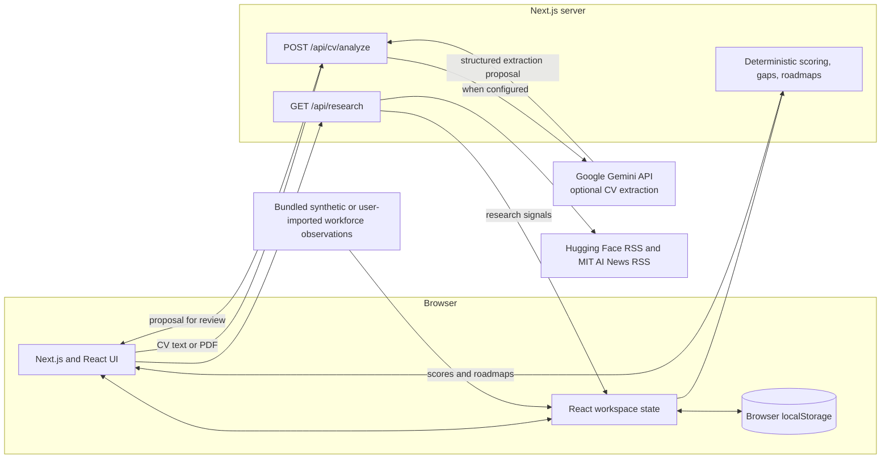

# SDC Hackathon 2026 Submission Template
## Phase 1 Preliminary Project Proposal

**Project:** SKILLAX AI Platform  
**Domain:** Domain 1 — Aiversecity Future-Ready Workforce  
**Draft status:** Team review and completion required

## Section 1 — Team & Project Overview

| Field | Draft answer |
|---|---|
| Team Name | [TEAM TO COMPLETE: Official team name] |
| Selected Domain | Domain 1 — Aiversecity Future-Ready Workforce |
| Selected SDG Track (1–17) | SDG 8 — Decent Work and Economic Growth (proposed primary); SDG 4 — Quality Education (proposed secondary). Confirm the track selection with the team. |
| Project / Solution Name | SKILLAX AI Platform |
| Name (Leader) | [TEAM TO COMPLETE: Team leader's full name] |
| Email & Phone (Leader) | [TEAM TO COMPLETE: Email] / [TEAM TO COMPLETE: Phone] |
| University Affiliation(s) | [TEAM TO CONFIRM: Institution(s) for all registered members]. The workspace location suggests a USM context, but does not verify the roster. |
| Number of Team Members | [TEAM TO COMPLETE: 1–5 members, per Official Handbook, Section 4.2.3] |

## Section 2 — Executive Summary & Problem Statement

### 2.1 The Problem Context — maximum 250 words

**Draft response (word count: 186):**

Workers, graduates and career changers need to make training and career decisions while occupational skill requirements are changing. The World Economic Forum's *Future of Jobs Report 2025* reports that employers expect 39% of workers' core skills to change by 2030; this is a global employer-survey estimate, not a Malaysia-specific forecast (published 7 January 2025). For Malaysia, Talent Corporation Malaysia's Impact Study examined 949 roles across 10 sectors and estimates that about 620,000 employees, approximately 18% of the workforce in those analysed sectors, may be significantly affected by technological and economic shifts (study launched 18 November 2024). The study also maps pathways for 84 highly impacted roles. These figures describe projected change and study scope; they do not establish that every worker has a skills deficit. SKILLAX addresses a narrower planning problem: an individual may lack a clear, inspectable way to compare their stated skills with a selected role, see the assumptions behind a suggested match, and turn identified gaps into learning steps. The prototype makes those comparisons explicit while distinguishing research activity from job-demand evidence. It has not yet demonstrated improved employment or reskilling outcomes.

**Evidence:** World Economic Forum, *The Future of Jobs Report 2025*, published 7 January 2025, https://www.weforum.org/publications/the-future-of-jobs-report-2025/in-full/3-skills-outlook/ . Talent Corporation Malaysia, *Impact Study of AI, Digital and Green Economy on the Malaysian Workforce*, launched 18 November 2024, https://www.talentcorp.com.my/resources/press-releases/talentcorp-launches-landmark-study-on-workforce-impact-of-ai-digitalisation-and-green-economy/ and https://www.talentcorp.com.my/impact-study/ . Accessed 24 October 2026.

### 2.2 The Proposed AI Solution — maximum 300 words

**Draft response (word count: 231):**

SKILLAX is a browser-based career exploration and reskilling prototype for workers, graduates and career changers, with a synthetic-cohort view for workforce planners. Users can enter a profile or try one of three synthetic CV examples; the CV endpoint can accept a PDF or text and, when server-side Gemini credentials are configured, request a structured extraction proposal. An offline keyword extractor is the fallback. Users review the proposal before merging it into their profile. The application compares the profile with ten hard-coded benchmark occupations using transparent TypeScript scoring, shows skill gaps, supports slower, moderate and rapid adoption scenarios, and generates a four-phase learning roadmap with milestone tracking. A dashboard, assessment wizard, progress view, recommendation review history, and SDG mapping are also implemented.

The model is used for CV information extraction only; career scores and rankings are calculated by deterministic functions. The Radar page fetches Hugging Face and MIT RSS items as research-activity signals. Its workforce-demand series are synthetic demonstration data and user-importable observations, not a live Malaysian vacancy feed. User workspace state is stored in browser localStorage; the application has no database. The repository contains a Replit configuration, but a public deployed instance and end-to-end Gemini service call have not been verified for this draft. Phase 2 should test the journey with intended users, replace synthetic demand data only with comparable authoritative data, and evaluate whether roadmap use changes measured skill gaps.

### 3. Technical Architecture & Implementation Plan

#### 3.1 Conceptual Tech Stack

- **Frontend:** Next.js 14 App Router, React 18, TypeScript, and Tailwind CSS. Versions in `package.json` are ranges; resolved versions are recorded in `package-lock.json`.
- **Server/API:** Next.js route handlers at `POST /api/cv/analyze` and `GET /api/research`.
- **AI:** `@google/genai` SDK. Code selects `process.env.GEMINI_MODEL` or defaults to `gemini-3.5-flash-lite`; this draft verifies the configured identifier and official model documentation, not a successful live API call. Gemini is only used by the CV extraction path.
- **Career logic:** deterministic functions in `src/lib/domain/` calculate skill gaps, scenario adjustments, match scores, and roadmaps. Baseline: 50% skills, 20% transferable skills, 15% interest, 15% research-activity signal. Where an eligible workforce series is present, overall match combines 90% baseline and 10% workforce score.
- **Data and persistence:** React context and browser localStorage (`skillax_workspace_v2`); no database service or connection is configured. Static catalogs and synthetic workforce observations are bundled in `src/lib/data/`. Raw CV files/text are posted to the server route; with Gemini configured, the extraction request sends document content to Google's API. Do not describe this as zero external processing or guaranteed deletion by third parties.
- **External data:** live public RSS requests from Hugging Face and MIT AI News for research activity only. Workforce observations are synthetic or user-imported.
- **Hosting:** local Next.js development is documented; `.replit` defines a Replit run/deploy configuration. No public deployment URL or sponsor-provided API/credit is evidenced. Replit use and sponsor-resource status require team confirmation.

#### 3.2 Design-Thinking & Deployment Strategy — maximum 200 words

**Draft response (word count: 155):**

The implemented interface provides a profile editor, a five-step assessment, synthetic sample profiles, score explanations, skill-gap views, scenario controls, and a roadmap with user-controlled milestone checkoffs. These choices support exploration without requiring a user to provide a real CV. CV extraction is staged for review rather than automatically merged. The repository contains automated domain tests and project records report 8/8 tests passing; the latest recorded build generated 19 routes. These are software checks, not evidence of user research or usability testing. No user interviews, usability study, pilot, or learning-outcome evaluation is evidenced in the reviewed materials. The prototype runs in a local development setup and includes `.replit` configuration, but public deployment and access by judges are unverified. Next steps are to obtain team and mentor review, test the main journey with a defined participant cohort using synthetic or consented data, deploy to a team-selected platform, and evaluate pre/post skill-gap measures before claiming impact.

### 4. Preliminary Environmental & SDG Impact Framework

1. **Target SDG Sub-Target(s):** Proposed alignment with Domain 1's listed targets: SDG 4.3 (access to technical, vocational and tertiary learning), 4.4 (relevant skills for employment), 8.2 (productivity through technological upgrading and innovation), and 8.5 (productive employment and decent work). SKILLAX supports career exploration and planning but has no measured contribution to these targets. UN target texts: https://sdgs.un.org/goals/goal4 and https://sdgs.un.org/goals/goal8 (accessed 24 October 2026).
2. **Current Problem Baseline:** Malaysia-focused reference baseline: TalentCorp's study covers 949 roles in 10 sectors and estimates about 620,000 employees (about 18% of the analysed-sector workforce) may be significantly affected. The study launched 18 November 2024. This is a projected exposure estimate, not a measured individual skill gap or a baseline for SKILLAX users. No defensible baseline for the prototype's users' skill gaps is currently available. Source details are cited in Section 2.1. The Domain 1 brief also cites 56% workplace AI-tool use and 26% formal training from Hays Asia Salary Guide 2025; this draft does not rely on these figures until the original Hays source is checked.
3. **Core Measurable KPI:** Mean role-specific skill-gap level per profile, calculated as the sum of positive differences between role-required and user-rated levels across the selected role's listed skills, divided by the number of listed skills (scale 0–5). Report the cohort mean before and after a defined learning period, plus cohort size and completion rate. Self-ratings are not independent competency validation.
4. **Phase 2 Impact Target:** Proposed target for team review: at least 20% reduction in mean role-specific gap level among a defined pilot cohort after a six-week guided-roadmap period, measured using the same skill rubric at baseline and follow-up. Report attrition and use a comparison group if feasible. This is a proposed evaluation target, not a result; the cohort, protocol and percentage require team approval before submission.

### 5. Eligibility & Readiness Checklist

| Checklist item | Draft status |
|---|---|
| All team members have completed the mandatory GenAI, Database, and Cloud Deployment upskilling workshops. | [TEAM TO CONFIRM: attendance for every registered member] |
| The project concept addresses a verified real-world problem mapped directly to one or more UN SDGs. | [TEAM TO CONFIRM: accept the evidence and SDG mapping in Section 4] |
| The proposed solution targets a functional, deployed application rather than a theoretical business case study. | Functional local prototype evidenced in repository; public deployment not verified. Team to confirm deployment requirement/link before marking complete. |
| All fields in the template have been completed within the word limits. | Not complete: personal/team placeholders and confirmations remain. Recheck all counts after edits. |

### 6. IP & Originality Declaration

#### 6.1 Pre-Existing / Prior-Owned Work

**[TEAM TO CONFIRM before signature]** The repository contains work dated during the hackathon period according to its Git history, but the repository history does not establish when all concepts, designs, code, or research originated, who authored each contribution, or ownership rights. State which submitted components predate the event, identify their owners and dates, and disclose any applicable third-party or institutional terms. Do not use a blanket claim that all work was created during the event.

#### 6.2 Third-Party Code, Datasets, or Models

Main direct dependencies and resolved versions/licenses are listed in Document 2, Section 2.2. The project uses the Google Gemini API under Google's applicable API terms, live public RSS feeds, and bundled public-reference metadata. The ten occupations and 19-skill taxonomy are manually represented in project files; occupation records include O*NET codes/links, but this audit did not verify a downloaded O*NET dataset or API use. O*NET attribution/license applicability and any adapted wording require team review. Synthetic workforce and demo-profile data are team-authored examples and must remain labelled synthetic. `src/lib/data/initialWorkforce.ts` currently contains the unsupported provider label “TalentCorp / MDEC Synthetic Working Group”; do not present that as a real source. Replace or explain it in the application before a final compliance declaration.

#### 6.3 Employment-Related IP Conflicts

**[TEAM TO COMPLETE]** Each member must disclose whether employment, internship, consulting, university, sponsor, or other agreements may affect ownership or permission to submit their contributions. Do not infer a “no conflicts” answer.

### 7. Declaration

**Team Leader Signature:** [TEAM TO SIGN]  
**Name:** [TEAM TO COMPLETE: Team leader's full name]  
**Date:** [TEAM TO COMPLETE: Date of signing]  
**University Affiliation(s):** [TEAM TO CONFIRM]

