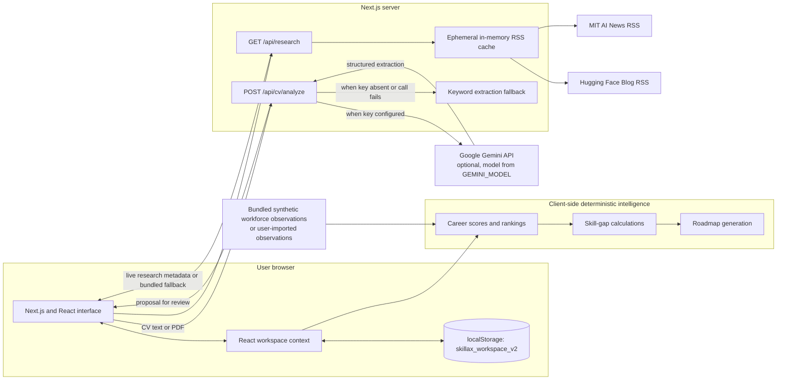

# SKILLAX AI System Architecture

Architecture reconstructed from the repository as reviewed on 24 October 2026. Solid components are present in code; Gemini is conditional on server configuration. There is no database or confirmed public hosting service.

## Data boundaries

- **Browser persistence:** Profile fields, ratings, scenario, imported workforce observations, saved roadmap, milestone completion and recommendation history are stored in `localStorage`. The app has no database integration.
- **CV path:** The route accepts a PDF up to 10 MB or pasted text. If Gemini is configured, content is sent to Google. The code calls `fileBuffer.fill(0)` after successful file extraction; there is no `finally` cleanup for all error paths, and this is not evidence of provider-side deletion.
- **Research path:** RSS items indicate technical research/news activity, not vacancies, wages or workforce demand. Workforce-series data are synthetic by default or imported by a user.
- **Hosting:** `.replit` contains Replit configuration; no live service URL is verified. Do not treat `localhost:3000` as judge-accessible.

