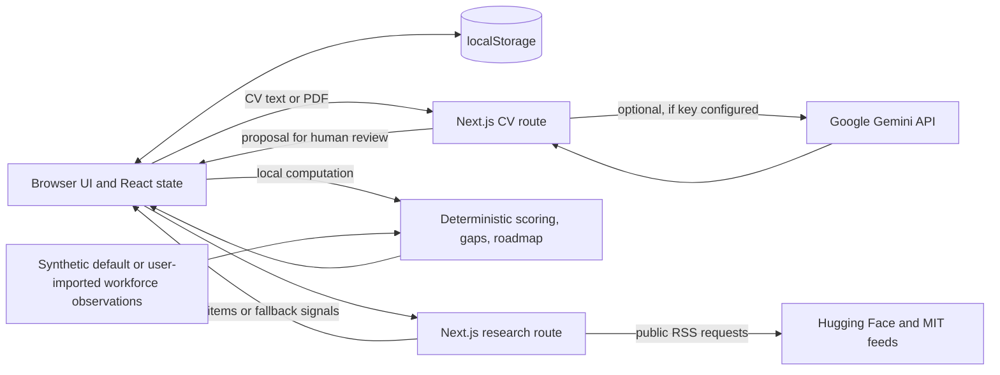

# SDC Hackathon 2026 Technical Tools Declaration Template

**Project:** SKILLAX AI Platform  
**Domain:** Domain 1 — Aiversecity Future-Ready Workforce  
**Draft status:** Team confirmation and signature required

## Section 1 — Team & Project Overview

| Field | Draft answer |
|---|---|
| Team Name | [TEAM TO COMPLETE: Official team name] |
| Project / Solution Name | SKILLAX AI Platform |
| Name (Leader) | [TEAM TO COMPLETE: Team leader's full name] |
| Email & Phone (Leader) | [TEAM TO COMPLETE: Email] / [TEAM TO COMPLETE: Phone] |
| University Affiliation(s) | [TEAM TO CONFIRM: Institution(s) for all registered members] |
| Live Prototype URL | [TEAM TO COMPLETE: Public deployment URL]. No public deployment URL is verified in the repository. `http://localhost:3000` is a local development address and is not judge-accessible. |
| Code Repository URL | `https://github.com/ado0330/SCD-prototype2` (configured Git origin; team must confirm public/judge access and the submitted branch/commit). |

## Section 2 — Architecture & Technology Stack

### 2.1 System Architecture Overview — maximum 200 words

**Draft response (word count: 159):**

The browser UI uses Next.js App Router and React state. Workspace state, including the profile and roadmap progress, is serialized to browser localStorage; no database is configured. The client sends CV text or a PDF to the Next.js `POST /api/cv/analyze` route. If a server-side Gemini key is configured, the route calls Google Gemini through `@google/genai` using the model ID in `GEMINI_MODEL` (default `gemini-3.5-flash-lite`); otherwise, or after a caught Gemini error, the code uses a keyword extractor. The structured proposal is returned for user review. The route sends content to Google when Gemini is active; provider retention/use depends on the account's billing tier and current terms. Career scores, gaps and roadmaps are calculated by local deterministic TypeScript functions. `GET /api/research` fetches Hugging Face and MIT RSS feeds and falls back to bundled signals. Workforce observations are synthetic defaults or user-imported data. `.replit` configures deployment commands, but a hosted instance is not verified.

### 2.2 Languages, Frameworks & Libraries

Versions below are the lockfile-resolved versions inspected on 24 October 2026; package ranges are in `package.json`. Licenses reflect `package-lock.json` metadata, not a full legal review of all transitive dependencies.

| Technology | Resolved version | License in lockfile | Purpose |
|---|---:|---|---|
| TypeScript | 5.9.3 | Apache-2.0 | Application and domain code; strict type checking is configured. |
| Next.js | 14.2.35 | MIT | App Router UI, server rendering and route handlers. |
| React / React DOM | 18.3.1 | MIT | Browser interface and component state. |
| Tailwind CSS | 3.4.19 | MIT | Styling and responsive design. |
| `@google/genai` | 2.31.0 | Apache-2.0 | Server-side Gemini SDK. |
| Zod | 3.25.76 | MIT | Runtime schema validation. |
| `lucide-react` | 0.453.0 | ISC | UI icons. |
| `clsx` | 2.1.1 | MIT | Conditional CSS class construction. |
| `tailwind-merge` | 2.6.1 | MIT | Tailwind class conflict resolution. |
| PostCSS / Autoprefixer | 8.5.31 / 10.6.1 | MIT / MIT | CSS processing and vendor prefixes. |
| `tsx` | 4.23.15 | MIT | Runs TypeScript test files with Node's test runner. |
| `@types/node`, `@types/react`, `@types/react-dom` | 20.19.43 / 18.3.31 / 18.3.7 | MIT / MIT / MIT | Development type definitions. |

The package manifest does not pin a Node.js runtime version. No full third-party license inventory of every transitive package was prepared; the lockfile provides resolved package versions and license metadata.

## Section 3 — APIs & Cloud Services

### 3.1 External APIs

| Provider / endpoint | Purpose and status | Access tier / notes |
|---|---|---|
| Google Gemini API (`generateContent`; model ID from `GEMINI_MODEL`, default `gemini-3.5-flash-lite`) | Runtime CV extraction only, if a valid server-side key is present. The code integration is verified; successful use with the current account/key is not. | Free or paid tier depends on the Google project and billing setup. Team must confirm which tier/key is used; no key or secret is included here. Google API terms apply. |
| Hugging Face Blog RSS (`https://huggingface.co/blog/feed.xml`) | Fetched by `GET /api/research` as technical research-activity metadata, not vacancy or wage data. | Public RSS endpoint; no sponsor status evidenced. |
| MIT AI News RSS (`https://news.mit.edu/rss/topic/artificial-intelligence2`) | Fetched by `GET /api/research` as a second research-activity signal. | Public RSS endpoint; no sponsor status evidenced. |

No live MyMAHIR, TalentCorp, DOSM, job-vacancy, learning-catalogue, search, embedding, or database API is found in the runtime code. Static learning links are not a catalogue API. RSS availability and third-party service terms remain external dependencies.

### 3.2 Cloud Platforms & Deployment

| Service | Evidence and status |
|---|---|
| GitHub | Git remote points to `https://github.com/ado0330/SCD-prototype2`. This confirms configured source-control origin, not judge access or a particular deployment. Team to verify repository visibility and access. |
| Replit | `.replit` includes run/build/deployment configuration for port 3000. Configuration is verified; actual account use, deployed app, plan and region are unverified. Participant Handbook §15.21 requires Replit use and §10.6 requires proof in the declaration, so collect evidence before submission. |
| Vercel | No Vercel deployment configuration or live URL was found. Do not declare it used unless the team confirms deployment. |
| Database, hosted storage, or authentication service | None found in the application configuration. Browser localStorage is client-side persistence. |
| Local development | Next.js scripts use port 3000. No public service is implied by local execution. |

## Section 4 — AI Tools, Models & Datasets

### 4.1 AI Models Used in the Solution

| Model | Provider and usage | Training status and terms |
|---|---|---|
| `gemini-3.5-flash-lite` (default model ID; environment override supported) | Google Gemini API via `@google/genai`; code uses it to extract structured profile proposals from CV text/PDF. Official model documentation lists this stable model ID and PDF input. Code integration verified; live API request not verified in this audit. | Pretrained hosted model; no fine-tuning or self-training found. Google Gemini API terms and account-specific data/billing terms apply. The model is not open-source software under a package license. |
| Deterministic keyword extractor | Team-authored TypeScript fallback; not an AI model. | No model training. |

### 4.2 Datasets

| Data/reference set | Source, type and purpose | License / personal data |
|---|---|---|
| Skill and occupation catalogues (`src/lib/data/skills.ts`, `roles.ts`) | Bundled, manually represented benchmark taxonomies; role entries include O*NET codes/links. No live O*NET API or downloaded O*NET database was identified. | Team-authored modifications and exact source reuse need team review. O*NET license/attribution applies only to material actually copied/adapted; attribution source: https://www.onetcenter.org/license_agreements.html. No personal data. |
| SDG reference catalog (`src/lib/data/sdgs.ts`) | Static UN SDG labels and project-authored mappings. | Cite the UN source; no personal data. https://sdgs.un.org/goals |
| Workforce observations (`src/lib/data/initialWorkforce.ts`) | Synthetic demonstration time series; users can also import observations. These are not real vacancy or wage statistics. | Synthetic records contain no personal data. No separate dataset license is declared. The source metadata currently names “TalentCorp / MDEC Synthetic Working Group”; no evidence supports that attribution. Team must correct/verify it before submission. |
| Synthetic workers and CV samples (`syntheticWorkers.ts`, `sampleCvs.ts`) | Team-authored fictional demonstration profiles. | Synthetic; no real personal data intended. Confirm content remains fictional. No separate data license is declared. |
| Learning resources (`learningResources.ts`) | Curated public URLs and project-authored learning descriptions; static list, no live course API. | Underlying providers retain their own terms; no imported course dataset identified. No personal data. |
| Research signal seeds (`fallbackSignals.ts`) | Bundled publication/news metadata used when live RSS is unavailable; live RSS metadata also fetched from Hugging Face and MIT. | Underlying articles remain under publisher terms; not training data. No personal data intended. |

**Training/evaluation statement:** No formal training or fine-tuning dataset is identified. No model training is implemented. Unit tests cover deterministic domain logic; no labeled human CV or outcome-evaluation corpus is evidenced. Synthetic examples are runtime/demo reference data, not a machine-learning training set.

### 4.3 AI-Assisted Development Tools

**Did the team use generative AI tools to create code, design, text, or project materials?** Yes — team confirmation required for a complete team-wide list.

| Tool | Evidence / version | Purpose and extent |
|---|---|---|
| Antigravity | Reported in the task context; exact edition/version unknown. | AI-assisted development is reported; individual users and extent (minor/moderate/major) require team confirmation. |
| Codex app (OpenAI; model/version not recorded here) | Used in this session to research and draft these submission documents. | Major assistance for these documents; not evidence of use in prior application-code development. Team to confirm any other use. |
| Other assistants (e.g. Gemini web, GitHub Copilot, Replit AI) | Unknown. | Each team member must confirm whether used, version, purpose and extent; do not list without confirmation. |

**Team review and responsibility statement — maximum 100 words**  
**Draft response (word count: 87):**

The codebase includes domain tests and schema validation, and project records report prior build and unit-test checks. This document set was prepared with AI assistance and then checked against repository files, the supplied handbooks and cited public sources. The team has not yet confirmed a complete list of tools used by every member, reviewed every generated contribution, or verified live Gemini and public deployment behavior for this declaration. The team must review the final documents, confirm individual contributions, and accept responsibility for all submitted work before signing.

## Section 5 — Sponsor-Provided Resources

**Did the team use official SDC sponsor-provided resources?** [TEAM TO CONFIRM: Yes / No]. No sponsor-provided API, cloud credit, dataset or computational resource is evidenced in the repository. The official handbooks mention the Aiversecity Orion AI Youth Leaders sponsor community, but that does not establish that the project used a technical resource.

| Sponsor | Resource | Project use | Essential or replaceable |
|---|---|---|---|
| [TEAM TO COMPLETE if Yes] | [Resource/API/credit] | [Actual use] | [Essential / replaceable, explain] |

**Replaceability statement — maximum 100 words**  
**Draft response (word count: 86):**

No sponsor-provided technical resource has been confirmed. The application is configured to run as a Next.js app and does not depend on a sponsor-specific API or database. Gemini is an optional external runtime service for CV extraction; the code includes a keyword-based fallback, and scoring and roadmap calculations run locally. If the team confirms use of sponsor credits or infrastructure, add the provider, resource, actual use and replacement plan here. Replaceability of any confirmed sponsor service must be assessed against the actual configuration before signing.

## Section 6 — Security, Privacy & Responsible Use

### 6.1 Data Handling & Privacy — maximum 150 words

**Draft response (word count: 138):**

The CV route accepts PDF files up to 10 MB or pasted text and requires two consent checkboxes. Code does not write raw CV files to disk or a database. If Gemini is configured, content is sent to Google; otherwise, the keyword fallback runs on the server. The route calls `fileBuffer.fill(0)` after successful file extraction, but this does not prove copies are erased on every error path or that providers retain nothing. Approved profile fields may persist in browser localStorage with interests, imported workforce data, roadmap and history. The app offers a workspace reset. Google states that unpaid Gemini content may be used to improve services and reviewed by humans; paid-service handling differs. Do not submit real or sensitive CVs until the team checks current Google terms, account tier and privacy notice. Demo profiles are synthetic.

### 6.2 Known Limitations & Risks — maximum 150 words

**Draft response (word count: 126):**

Gemini can misread CVs or infer unsupported skill levels; staged review is implemented, but no accuracy benchmark is evidenced. The keyword fallback may miss context. Career results are deterministic for fixed inputs, but use a small, manually authored catalogue and heuristic weights; they are not validated hiring predictions. Research RSS signals describe technical activity, not labor demand. Default workforce observations are synthetic; their source metadata has an unsupported provider name that needs correction. CV text sent to Gemini is subject to provider terms; buffer clearing does not prove complete deletion. No public deployment, live Gemini request, privacy review, bias assessment or user study is verified. Existing mitigations are schema validation, human review, synthetic examples and no database; independent evaluation and real comparable labor data remain planned.

## Section 7 — Compliance & Readiness Checklist

| Checklist item | Draft status |
|---|---|
| All APIs, cloud services, AI tools, models, and datasets used in the project are declared. | In progress: team-wide AI-tool list, Gemini account/tier, sponsor resources and imported datasets require confirmation. |
| Third-party code, datasets, and models comply with their licenses and attribution requirements. | Not confirmed: review actual reused O*NET/UN text, all package licenses/attributions, public feed terms and project ownership. Correct unsupported synthetic data provider label. |
| No API keys, passwords, or credentials are exposed. | No common API-key patterns were found in currently tracked files; `.gitignore` excludes `.env` and `.env*.local`. Full Git history, remote settings and runtime secret configuration were not audited. Keep pending for team sign-off. No `.env.local` values were read or printed. |
| AI-assisted development has been disclosed and reviewed by the team. | AI use is disclosed as reported; team-wide tool list and review/ownership statement require confirmation. |
| Official sponsor resources have been declared. | [TEAM TO CONFIRM: Yes/No and complete Section 5 if Yes.] |
| The prototype is accessible to judges through the provided links. | Not confirmed: public deployment URL and repository access need team verification. |
| All fields are completed within word limits. | Not complete: team placeholders remain; re-count limited fields after final edits. |

## Section 8 — Declaration

I confirm that, after team review, this declaration accurately lists the tools, services, AI models, datasets and development assistance used by the team.

**Team Leader Signature:** [TEAM TO SIGN]  
**Team Leader Name:** [TEAM TO COMPLETE]  
**University Affiliation(s):** [TEAM TO CONFIRM]  
**Date:** [TEAM TO COMPLETE]

